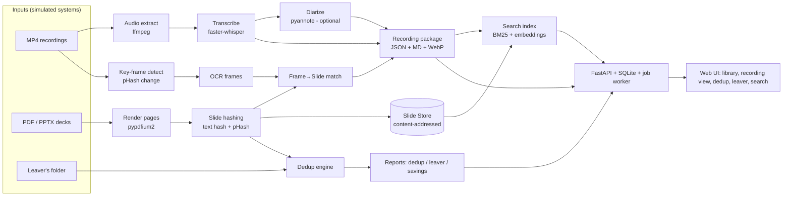

# PROJECT SPEC: Ericsson "Data Storage Optimization"

> **This is the core document of the project.** Every feature, line of code, slide and demo step must trace back to a requirement ID here.
> If it isn't in this file, it isn't in scope. If the brief asks for it, it's in this file.

- **Event:** Campor × BUILD Hackathon 2026, Fri 13 – Sun 15 Nov 2026, Black Box, Ericsson, Karlskrona
- **Challenge:** *Data Storage Optimization*, from Ericsson
- **Working name:** `DataDistill` (rename freely)
- **Sources:** Ericsson challenge brief (PDF) and campor.co/hackathon
- **Status legend:** `[ ]` not started · `[~]` in progress · `[x]` done and demo-ready

---

## 0. Mission in one paragraph

Ericsson keeps hours-long meeting and course recordings plus thousands of slide decks on SharePoint, OneDrive and Ericsson Play. They are too large, so valuable content gets **deleted**, and the same documents get **copied** across many people's drives. We build a tool that **distills** recordings into compact, linked text + key slide frames, **detects duplicates** of documents and slides across systems, and makes everything **searchable and AI-ready**. Storage drops by ~99% and no information that matters is lost.

**Two goals, as stated in the brief:**

| ID | Goal | Meaning |
|---|---|---|
| **G1** | **Storage reduction** | Replace video with text + key frames. Identify duplicates. |
| **G2** | **Data activation** | Make content searchable and consumable by AI. |

> Ericsson's note: *"partial solutions can reach the goal."* Depth beats breadth. A few use cases done fully and measured beat everything done halfway.

### 0.1 Current build scope (decided 11 Nov, evening). This overrides older UI sections.

**Product = recordings → speaker-attributed text + context. Nothing else in the UI for now.**

| Tab | What it does |
|---|---|
| **Upload data** | Folders (one per meeting or project; real directories under `data/`), upload into a folder, live progress per file (stage, %, elapsed, time left), result (duration, speakers, recognition confidence, processing time), move / re-process / remove |
| **Transcripts** | Folder tree. A recording shows its dialogue: speaker, timestamp, text and per-turn confidence, with shared screens inline (slide title, source document + doc no. + rev, slide text). Speaker panel shows where each name came from (screen / Teams captions / manual / voice only). Edit names and lines. A document shows its text per slide. **Downloads: JSON (AI-ready) and text, per file and per folder.** |
| **Search** | Meaning + keyword search over all transcripts and documents, with a folder filter. Results open the exact line. |

**Removed:** video/audio playback (keeping media would recreate the storage problem we are solving), the summary report (summaries are left to the user / downstream AI), and the Savings, Duplicates and Offboarding pages. The duplicates and offboarding backend is kept for the next phase.

**Speakers, named from the screen (camera on or off):**
1. *Who spoke when*: voice diarization (SpeechBrain ECAPA embeddings + agglomerative clustering, local, Apache-2.0) gives Speaker 1, 2, 3…, independent of cameras.
2. *Who is who*: name labels on participant tiles are read with OCR across sampled frames, and the tile grid is inferred from the label positions. For each voice cluster, the tile whose activity lines up best with that voice's speaking time gets the name. Activity cues:
   - the **speaking highlight border** (Teams/Zoom; also present for camera-off tiles with initials);
   - **in-tile motion** (lips/head with camera on, the animated speaking ring with camera off).
3. A match is accepted only above a minimum score and a clear margin over the second-best name. Otherwise the line stays "Speaker N", and the names seen on screen are offered for manual naming.
4. A Teams `.vtt` next to the recording overrides all of this with exact names.

**Blind test (11 Nov). Real meeting, nothing tuned to it:** a 29 min Zoom gallery recording, 640×360, about 200 kbit/s, 10 people on camera, no screen share, no captions.

| | Run 1 | After generic fixes |
|---|---|---|
| Processing time | 3 min 21 s | 3 min 20 s (≈ 9× real time) |
| Recognition confidence (mean / median / 10th pct) | 96% | 96% / 98% / 90%; 3 of 374 turns below 70% |
| False "shared screens" | 70 | **0** |
| Voices | 21 (over-split) | 8 |
| Names read from screen | 8 (3 junk: "GitLab", "Engnee", truncated) | 6, all real: Phil Calder, Thomas Woodham, Amar Patel, Wayne Haber, Ned McCorrison*, Jay Swain |
| Voices named | 6 of 21 (1 junk name) | 6 of 8 = **93% of talk time** named (method: movement; this copy has no highlight border) |
| Hand-off check ("…Thomas, you've got item B." → next speaker) | — | 6 of 6 consistent, 0 contradictions |

\*The label says "Neil McCorrison"; at 360p OCR reads "Ned". Missed entirely: Seth Berger, Mon Ray, Fernando Diaz (their labels were never read), so they stay "Speaker N".
Confidence = the speech model's own word probability, not a measured error rate. Name correctness is supported by indirect evidence only. A Teams recording with its `.vtt` is needed as a real answer key.

**Test round 2 (11 Nov, late): three real recordings, all 640×360**

| | Zoom staff meeting (29 min) | Teams room meeting (54 min) | GMCB Teams meeting + its slide PDF (34 min) |
|---|---|---|---|
| Recognition confidence | 96% | 83% | 96% |
| Second-model agreement | 92% of words | 65% of words | — |
| Processing time | 2 min 22 s | 4 min 43 s | 2 min 39 s |
| Slides matched to the uploaded deck | — (none shared) | — (no deck uploaded) | **11 stretches, pages 1–9, all correct**; the meeting's own agenda correctly marked "not in your documents" |
| Voices / named | 8 / **7** (6 from tiles, Fernando from "hey uh fernando here") | 13 / 1 (Tanya Carter, from speech) | 8 / **5** (Sarah, Dave, Tom, Katie from speech; Owen Foster from his tile, OCR-misspelled "Souter") |
| Junk names removed | — | agenda-table words, "Taboo", 1-letter initials | slide titles, ALL-CAPS logo text, "General Course" |

The confidence score was validated as real: it drops under added noise (e.g. 94% → 82%) and correlates −0.87 with second-model disagreement on the harder video.
Generic rules added in this round:
- A document table is not a tile grid.
- A label that appears in the shared slide's text is not a name.
- "Last, First" names are read as First Last.
- Names come from self-introductions.
- Camera-off avatars (2–3-letter initials) are detected.
- A slide match needs visual matches spread over the page, or matching whole text.
- Unreadable or app-chrome OCR is never stored.
- The voice cap applies only when 3+ names are visible.

**Measured once against human ground truth: AMI meeting ES2008a** (CC BY 4.0; 17 min, 4 speakers, room camera + headset mix, 2,675 reference words).
The test data and test tooling were removed afterwards at the team's request; these numbers are kept as evidence for the pitch.

**Real Zoom recordings (12 Nov, evening):** two public Zoom meetings exposed four weak spots: names read from shared content, faces matched during screen share, one fixed screen area, and mid-sentence speaker changes. All four were fixed: a layout timeline, names only from tiles in gallery view, names from being addressed, and speaker changes snapped to pauses. The report wording and formal votes were also fixed. Checked against hand-made expectations in `benchmarks/zoom-cases/`. Shared screens went from 1 to 29 and from 6 to 57. Wrong names went to zero (unsure voices are now unnamed). Details: `benchmarks/README.md`.

**Measurement tools rebuilt (12 Nov):** `datadistill accuracy` (WER, content words, DER, names against any human reference) and `datadistill questions` (are the answers still in the distilled output, and can the local AI answer them). 29 unit tests in `tests/`. Results on the synthetic demo meeting: WER 1.2%; 16 of 18 answers kept at first. The question test found a real bug: the OCR noise filter dropped correct slide lines with words outside its ~20k-word list ("optimisation", "rollout"). It was fixed the same day (word forms and compounds, checked on 3,014 real OCR lines: 0 lines lost, no noise let through). After the fix: 18 of 18 kept, and 17 of 18 answered by the local AI. Details and how to write references and questions: `benchmarks/README.md`. The AMI numbers were re-measured on 12 Nov after the chunking change (see above).

| Metric | Before accuracy upgrade | **After** | Note |
|---|---|---|---|
| Word error rate, fillers ignored | 19.3% | **15.7%** (≈ 84% word accuracy) | Overlapping 4-person talk; human reference is verbatim (false starts kept) |
| Content words found / of ours correct | 81.4% / — | **86.2% / 94.8%** | Meaning-level accuracy |
| Who-spoke-when error (DER, 0.25 s collar) | — | 28.7% (missed 9.6, false alarm 10.5, confusion 8.7) | |
| Names | 2 of 4 | **4 of 4 correct, 0 wrong** (all from self-introductions) | Jesse's name is on a split-off part of her voice |

**Re-measured 12 Nov** with the rebuilt tool, after the chunking change (AMI data downloaded again and deleted afterwards):
- word error rate **15.8%**, and meaningful words found / of ours correct **90% / 96%**;
- who-spoke-when error 29.5%; **91.5%** of our words carry the right person's name;
- names 3 of 4 right (Iain written "Ian"; Jessy's name on a split-off fifth voice; the 11 Nov count of 4 of 4 included that split voice);
- **question test from AMI's human summary:** 16 of 18 answers kept, local AI 13–14 of 18. Both lost answers are misheard numbers ("fifteen million" → "50 million", "twelve fifty" → "1250").

Details: `benchmarks/README.md`.

**Accuracy upgrade (measured, now in the pipeline):** loudness normalisation of the audio (`highpass + loudnorm`) and gentler speech detection (threshold 0.3, 1 s minimum silence, 0.8 s padding). Result: 19% fewer word errors at the same speed.
Tried and rejected because they didn't help or made things worse:
- the full large-v3 model (same accuracy, 2.6× slower);
- name/term hint lists (worse);
- previous-sentence context;
- a wider beam;
- re-decoding low-confidence passages;
- no speech detection at all (invents "Thank you." in silence).

**Toward 95% word accuracy:** that level is realistic for clean single-speaker audio (one person talking, good mic), not for a 4-person conversation with interruptions. The AMI test above is already the good case for audio (each person on a headset mic, mixed to one track, like a Teams call); a single microphone in the middle of a room would be clearly worse. On recordings with a Teams `.vtt`, the captions are used directly.

**Alignment with the brief (honest check):** the build covers R1, R3, R4, UC-T1, UC-T2, UC-F3/F4 (as text) and UC-L1. Still required for the pitch and not in the UI yet: **R2/R5 duplicates, R6 leaver flow, P3 % savings**. The backend for these exists and must be brought back before Sunday.

---

## 1. Event facts and hard constraints

| Item | Value |
|---|---|
| Team size | 2–5. **Teams lock at end of Day 1.** |
| Build window Day 1 | 11:25 – 15:45 (Ericsson challenge intro at 10:30) |
| Day 2 / Day 3 schedule | **Not published.** Get it at kickoff. |
| Judging (official, weights TBA at kickoff) | **(J1)** the problem being solved · **(J2)** how the solution works · **(J3)** how far you got · **(J4)** value & potential |
| Disqualification | Plagiarism, **misuse of partner data**, misconduct |
| Prize | 12,500 / 7,500 / 5,000 SEK, split equally |

**Constraints we impose on ourselves:**

| ID | Constraint | Why |
|---|---|---|
| **C1** | **All processing runs locally** (no cloud AI APIs on Ericsson files) | Partner data must not leak. Matches Ericsson's "no sensitive data" note and protects us from the "misuse of partner data" DQ rule. |
| **C2** | **Never really delete anything.** Deletion is a *dry-run report* plus a recommendation. | The brief says "deleted only if a duplicate already exists". We prove it is safe; humans press the button. |
| **C3** | **Every number in the pitch is measured** on the sample files, then extrapolated with stated assumptions | Pitch item P3 asks for scenario-based % savings. Judges trust measured numbers. |
| **C4** | Must work on **older recordings without transcripts** | The brief says older files have no transcript, so we transcribe ourselves. |
| **C5** | Output uses **open formats only** (JSON, Markdown, WebP/JPEG, Opus) | Future-proof data strategy (P4) |
| **C6** | **Zero cost, permissive licences only** (MIT / BSD / Apache / MPL). No paid APIs, no AGPL libraries, no hosted services. Rules in §1.1. | Ericsson can adopt the result without licence or cost issues. It also strengthens J4 (value and potential). |

### 1.1 Licence and cost rules (audited 11 Nov 2026)

All installed Python packages were checked (`importlib.metadata`). **One problem was found and removed: PyMuPDF.**

**✅ Allowed (free, permissive). This is our stack:**

| Component | Licence |
|---|---|
| faster-whisper, CTranslate2, Whisper model weights (incl. large-v3-turbo) | MIT |
| PyTorch | BSD-style |
| pypdfium2 (PDF render/text/metadata) | Apache-2.0 / BSD-3 |
| pdfplumber, pdfminer.six | MIT |
| reportlab (report PDF) | BSD |
| Ollama (local model server) + Ministral 3 8B (`ministral-3:8b`, Mistral AI, EU) for meeting summaries | MIT / Apache-2.0. Team rule: no Chinese models; Llama or Mistral only |
| python-pptx | MIT |
| OpenCV (incl. SIFT, patent expired 2020), imagehash, Pillow | Apache-2.0 / BSD / MIT-CMU |
| Tesseract + pytesseract | Apache-2.0 |
| rapidfuzz, rank_bm25, FAISS | MIT / Apache-2.0 / MIT |
| sentence-transformers + all-MiniLM-L6-v2 | Apache-2.0 |
| FastAPI, Uvicorn, SQLite, React, Vite, Tailwind (web UI, run **locally** only) | MIT / BSD-3 / public domain |
| Lucide icons (`lucide-react`), Plus Jakarta Sans font (`@fontsource-variable/plus-jakarta-sans`) with Inter as fallback (`@fontsource-variable/inter`), both bundled, no CDN | ISC / OFL-1.1 |
| reportlab (summary report PDF) | BSD |
| PyAV, numpy, scipy, pandas, onnxruntime, transformers | BSD / MIT / Apache |

**🟡 Allowed with care:**

| Component | Licence | Rule |
|---|---|---|
| ffmpeg (Gyan "full" build) | **GPL-3.0** | Call it only as a **separate CLI process** (subprocess). Never link it into our code. For production, an LGPL build exists. |
| LibreOffice (PPTX → PDF) | MPL-2.0 | Free. Same rule: call it as a CLI. |
| pyannote.audio + `speaker-diarization-3.1` | MIT, but **gated** | Free. Needs a Hugging Face account and accepting the model terms. Do **not** use paid pyannoteAI models. |
| Local LLM / VLM (Ollama etc.) | Varies per model | **Check the model card.** Use only Apache-2.0 / MIT models. Llama and Gemma have their own custom terms, so avoid them. |
| TTS for video recreation | Varies | Windows built-in voice (SAPI) is fine for the demo. Check the licence of any downloaded voice. |

**❌ Ruled out:**

| Item | Why |
|---|---|
| **PyMuPDF / pymupdf4llm / pymupdf_layout** | **AGPL-3.0 or a paid Artifex licence.** Removed and replaced by pypdfium2 + pdfplumber. |
| Aspose.Slides / Aspose.PDF, Adobe PDF Services, ABBYY | Paid licences |
| Cloud AI APIs: OpenAI, Anthropic, Azure Speech/Vision, AWS Transcribe/Textract, Google Cloud Speech/Vision, AssemblyAI, Deepgram, ElevenLabs | Cost **and** partner data leaves the laptop (C1) |
| Hosted vector DBs (Pinecone, Weaviate Cloud…) | Cost + data leaves (FAISS covers our needs) |
| Hosting the demo on Streamlit Community Cloud / HF Spaces | Would upload partner data. Demo runs on localhost only. |
| Microsoft Graph / SharePoint APIs | Not paid, but we have no Ericsson tenant access. Further work only. |
| Lovable (partner) or any hosted AI app builder for the UI | Hosted, and paid beyond free credits. The UI would send partner data off the laptop. Only usable for a mock-up with **fake** data. |

Web UI stack (all free and permissive): **FastAPI** (MIT), **Uvicorn** (BSD-3), **SQLite** (public domain), **React + Vite + TypeScript** (MIT), **Tailwind CSS** (MIT). Streamlit has been **dropped** (see §4.11).

### 1.2 Primary scenario: Microsoft Teams meeting recordings (decided 11 Nov)

We **build for Teams recordings first** and adapt if the samples differ. What that means:

| Teams fact | Implication for us |
|---|---|
| The MP4 is usually 1080p H.264/AAC. Screen share fills the main area, with presenter video tile(s) or a participant strip at the edge. | Detect the **shared-content region once per recording** (step 0, §4.2), then analyse only that crop |
| The presenter may share the **PowerPoint editor window** (thumbnails pane + notes visible), not slideshow mode, or share the whole desktop | OCR will also read the thumbnail pane, so OCR **only the detected slide region**. Homography matching still works on a small slide. |
| Parts of the meeting have **no screen share** (gallery view, people talking) | These spans are `non_slide`. The knowledge is only in the transcript, which is fine. |
| Teams can create a **transcript (.vtt / .docx) with real speaker names**. It is stored *separately* from the MP4. Old recordings have none. | If a `.vtt` exists, use it, and speaker names come for free. Otherwise run Whisper (+ optional diarization). **Ask Ericsson whether the samples include .vtt files.** |
| Name labels are shown on video tiles | COULD: OCR the name of the highlighted (active) speaker tile to name speakers without diarization |
| Teams recordings often have an **auto-expiry date** (tenant setting) | Strong pitch point: recordings disappear automatically, so we distil them *before* they expire |
| Screen share can be Excel, a browser or a code demo instead of slides | Kept as `unknown_slide` key frames. Named as a limitation in P5. |

---

## 2. Requirements traceability (the core of this document)

Priority: **MUST** = needed for a credible demo · **SHOULD** = what wins · **COULD** = stretch.

### 2.1 Core requirements (from "The Challenge")

| ID | Requirement (from brief) | Prio | How we solve it | Acceptance criteria | Status |
|---|---|---|---|---|---|
| **R1** | Replace video content with **text and key frames** | MUST | Transcribe audio (faster-whisper) + extract slide key frames by perceptual-hash change detection | A sample MP4 produces `transcript.json`, `transcript.md` and `slides/*.webp`, and the package is ≥ 95% smaller | `[ ]` |
| **R2** | **Identify duplicates** (files *and* information across systems) | MUST | 3-level hashing: file SHA-256 → per-slide text hash → per-slide perceptual hash | The "(1).pdf" copies are flagged as exact duplicates. Decks that share slides are flagged with the shared slide list. | `[ ]` |
| **R3** | Make content **searchable** | MUST→SHOULD | Hybrid search (BM25 + local embeddings) over transcript chunks + slide OCR text | A query returns frame image + text + timestamp (see UC-S1) | `[ ]` |
| **R4** | Make content **consumable by AI** | MUST | Every recording becomes a structured JSON + Markdown package with metadata, time-linked segments and slide IDs (schema §5) | The package validates against the schema and can be pasted or loaded into any LLM/RAG pipeline | `[ ]` |
| **R5** | **Distill, compress, find duplicates across systems** | MUST | Treat each input folder as a "system" (e.g. `sharepoint/`, `onedrive_alice/`). The dedup index spans all of them. | The report shows where each duplicate lives (system + path) | `[ ]` |
| **R6** | **Leaver flow**: analyse the files of someone who leaves, compare with existing copies, delete **only if a duplicate exists** | SHOULD (it is explicitly in the brief, so treat it as near-MUST) | `leaver` command classifies each file as SAFE_DELETE / KEEP / REVIEW (logic in §4.6) | Leaver report with a per-file verdict, the reason, and the location of the surviving copy | `[ ]` |

### 2.2 Recording use cases: text

| ID | Use case | Prio | How | Acceptance | Status |
|---|---|---|---|---|---|
| **UC-T1** | Capture recording text **as plain text** | MUST | faster-whisper with word timestamps + VAD filter | Readable `transcript.md` with `[hh:mm:ss]` markers | `[ ]` |
| **UC-T2** | …**with each speaker identified** | SHOULD | Diarization (pyannote 3.x or WhisperX). Fallback: none. | Segments carry `speaker: "S1"`, `"S2"`… Optional manual name mapping. | `[ ]` |

### 2.3 Recording use cases: slide frames (the brief's 5 levels of complexity)

| ID | Level | Prio | How | Acceptance | Status |
|---|---|---|---|---|---|
| **UC-F1** | A **screenshot** of a slide | MUST | Key-frame detection (§4.2) | One image per distinct slide shown, no near-duplicates | `[ ]` |
| **UC-F2** | …**compressed** | MUST | WebP q≈70 (or JPEG q≈75), max width 1280 | Average frame ≤ 80 KB. Text still readable. | `[ ]` |
| **UC-F3** | …**identified by document number and slide number** | SHOULD | Match the frame against rendered pages of the provided PDFs (OCR text + pHash, §4.4) | ≥ 80% of frames matched to the correct `doc_no` + `page` on sample data | `[ ]` |
| **UC-F4** | …**linked to a single source of truth** | SHOULD | A global **Slide Store** keyed by `slide_uid`. The frame references the canonical slide + canonical document revision. | Clicking a frame in the UI shows the canonical document/page it comes from | `[ ]` |
| **UC-F5** | …**described in a text prompt so the slide can be recreated** | COULD | OCR text + layout description (local VLM if available, else a structured template: title, bullets, figure caption) | `slide_prompt` field present. A sample slide is recreated from it. | `[ ]` |

### 2.4 Recording use cases: linking, search, reconstruction

| ID | Use case | Prio | How | Acceptance | Status |
|---|---|---|---|---|---|
| **UC-E1** | Recorded event compressed into **plain ASCII text, an image, a unique slide identifier or a voice sample** | MUST (text + image + id), COULD (voice sample) | Package = transcript + frames + `slide_uid`s. Optional: short Opus voice sample per speaker. | All four artifact types present in the package | `[ ]` |
| **UC-L1** | **Extracted text time-linked to the frame** ("as you see here" still makes sense) | MUST | Every transcript segment gets the `slide_uid` that was on screen at its timestamp | `transcript.md` shows the slide thumbnail/ID inline at each slide change | `[ ]` |
| **UC-S1** | **Search for a subject returns the matching frame and text** | SHOULD (core of G2) | Hybrid search (§4.7) + web UI (UI-7) | Query "X" returns a ranked list: frame image, text snippet, recording, timestamp, source doc/page | `[ ]` |
| **UC-V1** | **Can the recording be recreated as a video** from this data? | COULD | ffmpeg slideshow: frames held for their time ranges + (a) kept Opus audio or (b) local TTS of the transcript | A recreated MP4 for a 5–10 min excerpt, with its size compared | `[ ]` |

### 2.5 Document use cases (files, presentations, slides)

| ID | Use case | Prio | How | Acceptance | Status |
|---|---|---|---|---|---|
| **UC-D1** | **How can duplicated data be identified and handled?** | MUST | Dedup levels L0–L3 (§4.5) + handling policy (keep canonical, replace copies with a reference) | Dedup report lists groups, the canonical copy and the bytes reclaimable | `[ ]` |
| **UC-D2** | **Break PDFs and PowerPoints into slides, each with a hash as identifier**, so identical slides compare quickly. Optional: doc number and file name. | MUST | pypdfium2 for PDF, python-pptx for PPTX (or convert PPTX→PDF via LibreOffice). Per slide: `text_hash`, `phash`, `slide_uid`. | `slides_index.json` with one row per slide incl. `doc_no`, `file_name`, `page`, hashes | `[ ]` |
| **UC-D3** | **Presentations with several revisions, each with minor changes** | SHOULD | Group into a **document family** (same doc_no, or slide overlap ≥ 50%). Content-addressed slide store: unchanged slides stored once, revisions = lists of slide IDs. Show the slide-level diff. | For a v1/v2 pair: "18/20 slides identical, 2 changed (slide 4, 11)" + storage saved | `[ ]` |

### 2.6 Sample material we must handle (from brief)

| ID | Ericsson provides | We must show | Status |
|---|---|---|---|
| **SD1** | MP4 recordings of an event | Distilled package + measured savings | `[ ]` |
| **SD2** | PDFs presented at the event | Slides indexed. Video frames matched to them (UC-F3). | `[ ]` |
| **SD3** | Duplicates with a suffix like **"(1).pdf"** | Detected as exact duplicates **by content, not by name** (the name is only a hint) | `[ ]` |
| **SD4** | Presentations that **share some slides** | Shared slides listed, with slide-level savings | `[ ]` |
| **SD5** | Metadata: **document number, revision, author, date** | Extracted (PDF metadata / PPTX core props / first-page text regex) and used for families + canonical choice | `[ ]` |

> "Including but not limited to": expect surprises (other formats, other video types). The pipeline must fail gracefully per file and log, never crash the run.

### 2.7 Final pitch (mandatory, from brief)

| ID | The pitch must present | Our content | Evidence to show | Status |
|---|---|---|---|---|
| **P1** | Which **use cases** we addressed | The checklist table from §2 with ✅/🟡/❌ | One slide: the requirement matrix | `[ ]` |
| **P2** | **How we solved them technically** | Architecture diagram (§3) + 3 key algorithms (key frames, slide hashing, leaver logic) | Live demo | `[ ]` |
| **P3** | **Scenario-based % savings in data volume** | Measured on sample data + 3 scenarios (§6) | Savings report generated by the tool | `[ ]` |
| **P4** | A **future-proof data strategy** supporting a **data-driven AI approach** | §7 | One diagram: tiers + slide store + AI layer | `[ ]` |
| **P5** | **Further work and unresolved problems** | §11 | An honest list, which builds trust | `[ ]` |

---

## 3. What is NOT required (explicitly out of scope)

| Not doing | Reason |
|---|---|
| Real SharePoint / OneDrive / Ericsson Play integration | No access. Folders simulate "systems". Mention the Microsoft Graph API as further work. |
| Actually deleting files | C2: dry-run reports only |
| Training or fine-tuning models | Pretrained local models are enough. The output *enables* future training. |
| Perfect transcription / OCR accuracy | We report accuracy honestly. The pipeline is model-agnostic. |
| Production auth, multi-user, scaling infra | Mention in the strategy, don't build |
| Handling every video type (demos, live coding, camera-only) | Focus on slide-based recordings and name the rest in P5 |
| A pixel-perfect frontend | The web UI (§4.11) must be functional and clean, not fancy. The demo carries the story. |

---

## 4. Technical design

### 4.1 Architecture



### 4.2 Slide identification in video (R1, UC-F1–F4, UC-L1). Revised 11 Nov.

> **Why it was revised:** v1 compared hashes of the *whole frame*. That only works for clean, full-screen slide captures. Real recordings are more likely to be:
> **(A)** a Teams/Zoom screen share: the slide is in a sub-region, with toolbars, a webcam tile, the mouse pointer, maybe presenter view;
> **(B)** a filmed event (Ericsson Play): camera cuts between speaker, audience, the projector screen and picture-in-picture;
> **(C)** a slide-only screen capture (the easy case).
> In A and B the webcam/camera changes all the time, so whole-frame hashes produce false slide changes and **never** match the clean PDF page.
> **Key insight:** Ericsson provides the PDFs that were presented. Slide identification is therefore mainly **retrieval** (which known page is on screen right now?), with change detection only as a fallback.

**Pipeline v2:**

| Step | What | How |
|---|---|---|
| 0. Find the shared-content region (Teams) | One crop box per recording (or per screen-share span) | Per-pixel change rate over the whole video at low res. Webcam tiles change constantly; the shared screen is mostly static between slide changes. The largest low-variance rectangle is the content area. Check it visually in the UI and allow a manual override. |
| 1. Sample + change gate | 1 frame per second at 1280 px, but **only analyse frames whose crop changed** (dHash Hamming > 6), plus a re-check every 15 s | ffmpeg CLI → raw frames (fast, no PyAV). **Performance:** OCR + SIFT on all 7,200 frames of a 2 h video would take 30–60 min. Gating cuts this to around 100–300 frames. |
| 2. Reference library | Every provided PDF page (PPTX via LibreOffice → PDF) | pypdfium2 render at 1280 px + embedded text + OCR + pHash + SIFT/ORB keypoints. Optional: image embedding (SigLIP/CLIP, Apache/MIT). |
| 3. Candidate retrieval | For each frame, the top-5 likely pages | OCR the frame (preprocessed: grayscale, autocontrast, invert dark headers) → BM25 + rapidfuzz against page texts. Image embedding for text-poor slides. |
| 4. Geometric verification | Confirm the page and find **where** it is in the frame | SIFT (or ORB) matching + RANSAC homography. Accept if inliers ≥ ~25 (tune on samples). This gives the page id + the slide's quadrilateral, which works for crops, webcam tiles and camera perspective. |
| 5. Temporal smoothing | Turn per-second labels into clean segments | Minimum duration 2 s. Majority vote in a 5 s window. Prior: same page or ±1 (talks go mostly sequentially). Merge runs → `[t_start, t_end, doc, page]`. |
| 6. Unmatched spans | Seconds with no verified page | **Slide-like but unknown** (stable, text-dense rectangle): run the v1 change detection *inside the detected slide region*, keep the last stable frame, rectify and crop it. **Camera/people/demo**: no slide. Keep 1 thumbnail per scene, flagged `non_slide`. |
| 7. Output | What we store | For matched segments, store the **clean reference page image** from the PDF (sharper *and* smaller than a video frame) via its `slide_uid`, plus an optional tiny cropped frame as evidence. For unknown slides, store the rectified crop as WebP q70. |

**Edge cases handled:**
- **Animations/builds:** partial states match the same page, so they stay one segment. If the PDF exports each build step as its own page, adjacent pages are allowed.
- **Going back to an earlier slide:** a new segment pointing to the same `slide_uid`. Occurrences are listed in the slide store.
- **Recording with no source deck** (older content): v1 change detection on the detected slide region + an OCR-text-change check. The resulting frames are still deduplicated against the global slide store (they may match decks from *other* events).

**v1 change detection** (fallback, used in step 6 and for case C): downscale to 320 px grayscale, dHash. A new slide starts when Hamming > 10 **and** the frame stays stable ≥ 2 s. Keep the last stable frame. Alternative: `ffmpeg -vf "select='gt(scene,0.3)'"`.

**Output:** `slides[] = {slide_idx, t_start, t_end, slide_uid, match: {doc, page, inliers, score} | null, kind: slide|unknown_slide|non_slide, image}`.

### 4.2.1 Measuring slide identification quality (J3: "how far you got")
- **Ground truth:** hand-label one sample video (≈ 30 min of work). Every slide change gets `(time, doc, page)`.
- **Metrics:** % of slide changes found within ±2 s · % of segments with the correct page · false slide changes per hour · % of time left unmatched.
- **Synthetic stress tests** (extend `scripts/make_test_media.py`):
  1. Teams-like layout: slide at 75% + webcam tile + toolbar
  2. Camera view: perspective warp + noise + blur
  3. Build animation: bullets appear one by one
  4. Presenter jumps back to slide 2
  5. One slide that is not in the PDF
  6. Heavy compression (low bitrate)
- Put the numbers in the pitch. Judges trust measured accuracy more than claims.

### 4.3 Transcription (UC-T1/T2)
- `faster-whisper`, `compute_type=int8`, `vad_filter=True`, `word_timestamps=True`. Model size chosen by the pre-event benchmark (§10).
- Diarization: `pyannote/speaker-diarization-3.1` (needs a Hugging Face token + accepted model terms) **or** WhisperX. Assign a speaker per segment by max time overlap.
- Already-transcribed new recordings: also accept `.vtt`/`.srt` input and skip ASR (the brief says new recordings may have transcripts). Teams `.vtt` contains `<v Speaker Name>` tags, so parse speaker names from them.
- **Hallucination guard:** Whisper can invent text during silence or music ("Thanks for watching…") and can loop on long audio. Use `vad_filter=True` and `condition_on_previous_text=False`, and drop segments with `no_speech_prob > 0.6` and low `avg_logprob`.
- **Store confidence per segment** (`avg_logprob`, `no_speech_prob`). Show low-confidence lines in the UI. This matters because the transcript becomes AI training data, and errors would be learned as truth.
- **Decode audio with the ffmpeg CLI** to a float32 array (PyAV 19 breaks faster-whisper's own decoder; see §10.1).
- **Domain vocabulary:** pass the matched deck's titles and acronyms as `initial_prompt` / `hotwords`. This improves Ericsson jargon (RAN, 5G NR, product names).
- **Language:** auto-detect per recording. large-v3-turbo handles Swedish and English. If content is Swedish, switch the search embeddings to `paraphrase-multilingual-MiniLM-L12-v2` (Apache-2.0).
- **Split segments at slide boundaries** using word timestamps, so a sentence is linked to the slide it was actually spoken over (UC-L1).

### 4.4 Frame → source slide matching (UC-F3/F4)
This is now part of the slide-identification pipeline (§4.2, steps 2–5). Summary: OCR/text retrieval gives the top-5 candidate pages, SIFT + RANSAC homography verifies the match, and temporal smoothing cleans up the segments. A matched segment inherits the page's `slide_uid`, `doc_no` and `page`. Unmatched segments are kept as `unknown_slide`, with their own uid.

### 4.5 Hashing and dedup levels (R2, UC-D1/D2, SD3/SD4)

| Level | What | Hash | Finds |
|---|---|---|---|
| **L0** | Whole file bytes | `sha256(file)` | Exact copies, e.g. `deck (1).pdf` |
| **L1** | Normalised file name | strip ` (1)`, `- Copy`, `_v2`, case | Hint only, never proof |
| **L2** | Slide text | `sha256(normalise(text))` (lowercase, collapse whitespace, strip page numbers/dates in footers) | Same slide in different decks, even if re-exported |
| **L3** | Slide visuals | 64-bit `phash` on the render, Hamming ≤ 6 = same, ≤ 12 = near | Image-only slides, minor visual edits |

| **LV** | Whole video (re-encoded copies) | Duration + sequence of 1-fps dHashes. Duplicate if duration is within 1% and ≥ 90% of aligned per-second hashes are within Hamming ≤ 8. | The same recording on Ericsson Play *and* SharePoint, re-encoded, so the SHA-256 differs |

**Slide identity:** `slide_uid = sha256(normalised_text + "|" + phash_hex)[:16]`, computed on **reference pages** (clean PDF/PPTX renders).
- A video segment matched to a page **inherits that page's uid**. A video-frame hash never equals a PDF render hash, so video frames must not define their own uid when a match exists.
- An `unknown_slide` from video gets its uid from its rectified crop and is still checked against the store by L2/L3 similarity.
- PPTX text hash can come straight from python-pptx (slide XML text), with no rendering needed. Rendering (LibreOffice) is only needed for pHash.
- Exact-same slide = same `slide_uid`. Near-same = same text hash OR phash distance ≤ 12 → **REVIEW**.
- Text-less pages (image-only): rely on pHash and image embeddings, and never auto-merge them.

**Handling policy (UC-D1, "how handled"):**
1. Choose a **canonical** copy: has a doc number > newest revision > oldest upload on a shared system (SharePoint) > personal drive.
2. Replace non-canonical copies with a **reference stub** (`.json` pointer to the canonical copy + hash).
3. Report reclaimable bytes.

### 4.6 Leaver flow (R6)
> **13 Nov: superseded in the product by §13.3** (employee offboarding through Microsoft 365 / Graph, with a quarantine and a layered safety design). The rules below remain the design reference for what counts as safe to remove.

For each file `F` in the leaver's folder, compared against all other systems:

| Condition | Verdict | Reason shown |
|---|---|---|
| L0 sha256 matches a file elsewhere | **SAFE_DELETE** | "Exact copy at `sharepoint/…/X.pdf`" |
| Deck whose **every** slide_uid exists elsewhere | **SAFE_DELETE (content-covered)** | "All 24 slides exist in A.pdf (1–20), B.pdf (5–8)" |
| Some slides unique | **REVIEW**. Option: keep only the unique slides as a mini-deck. | "3/24 slides unique: 7, 15, 22" |
| No match at all | **KEEP** (migrate to a shared archive) | "Unique content" |
| Video | Distill → package. **SAFE_DELETE** only if the same video exists elsewhere (L0 hash **or** LV fingerprint for re-encoded copies). Otherwise ARCHIVE_DISTILLED. | "Same recording as `ericsson_play/…mp4` (re-encoded, 97% frame match)" |

Output: `leaver_report.md` + `.json`, with totals: bytes safe to delete, bytes to keep, files to review.

**Safety rules. A "duplicate exists" verdict is only valid if the surviving copy is:**
1. **Not itself a deletion candidate.** This prevents *circular deletion*: two leavers, or two copies in the same batch, each pointing at the other, and both get deleted. Resolve canonical copies for the whole batch **first**, lock them, then classify.
2. **In a retained location** (a shared site, not another personal OneDrive that may be cleaned next).
3. **Accessible to the same audience.** If the only other copy sits on a restricted site, deleting the open copy removes access for people. Mark it REVIEW.
4. **The same information-classification level.** Never resolve a copy into a document with a different label (e.g. Internal vs Confidential).
5. **Not under legal hold or a retention policy.** Flag only, and assume a hold may exist (we cannot see it).
- "Delete" in the UI = **move to `_quarantine/`** (reversible) + an audit-log entry. Never a hard delete (C2).

### 4.7 Search (R3, UC-S1)
- **Chunk** = one slide segment of a recording: (speech during the slide's time range + OCR text of the slide). Document slides are chunks too.
- Index: **BM25** (`rank_bm25`) + **embeddings** (13 Nov: `paraphrase-multilingual-MiniLM-L12-v2`, local, 384-dim; before: all-MiniLM-L6-v2), fused by **reciprocal rank fusion**, top 30 **re-ranked** by a multilingual cross-encoder (`mmarco-mMiniLMv2-L12-H384-v1`, Apache-2.0). See §13.3 and `benchmarks/README.md` for the measured effect.
- Result card: frame thumbnail · snippet · recording + `hh:mm:ss` · source `doc_no` / page · "open video at t".
- COULD: local LLM (Ollama) answers questions with citations to frames/timestamps (RAG).

### 4.8 Video recreation (UC-V1, COULD): dropped 12 Nov, see §13.2
`ffmpeg` concat demuxer: each frame shown for `t_end - t_start` seconds + audio track (kept Opus, or local TTS such as Piper). Show the recreated excerpt next to the original and compare sizes.

### 4.9 Tech stack

| Area | Choice | Fallback |
|---|---|---|
| Language | Python 3.11 | — |
| Video/audio | ffmpeg, OpenCV | PyAV |
| ASR | faster-whisper | openai-whisper |
| Diarization | pyannote.audio 3.x | WhisperX / skip |
| OCR | Tesseract (pytesseract) | EasyOCR (Apache-2.0) |
| PDF | **pypdfium2** (render, text, metadata) + pdfplumber (text positions) | — (**not PyMuPDF**: AGPL, see §1.1) |
| PPTX | python-pptx (+ LibreOffice → PDF for rendering) | — |
| Hashing | hashlib, imagehash | — |
| Slide matching | OpenCV SIFT/ORB + RANSAC homography | Image embeddings (SigLIP / open_clip) |
| Fuzzy text | rapidfuzz | difflib |
| Search | rank_bm25, sentence-transformers, (FAISS) | BM25 only |
| UI | **FastAPI backend + React/Vite frontend** (§4.11) | Static HTML report |
| Metadata / jobs | SQLite | JSON files |
| Images | Pillow (WebP) | JPEG |

### 4.10 Repo layout and CLI

```
web/                  # React + Vite + TS frontend (UI-1..UI-8)
src/datadistill/
  api.py              # FastAPI app (routes in §4.11)
  db.py  jobs.py      # SQLite models, background job worker
  cli.py              # entry point
  video/keyframes.py  video/transcribe.py  video/diarize.py  video/package.py
  docs/extract.py     docs/hashing.py      docs/metadata.py
  match.py            # frame -> source slide
  dedup.py  lines.py  leaver.py  savings.py
  search/index.py     search/query.py
data/            # Ericsson samples (NEVER commit, see .gitignore)
output/          # generated packages and reports
PROJECT_SPEC.md  # this file
```

```bash
datadistill video  data/rec.mp4 --docs data/pdfs/      # R1, UC-T*, UC-F*, UC-L1
datadistill docs   data/                              # UC-D2, SD5
datadistill dedup  data/sharepoint data/onedrive_*    # R2, R5, UC-D1, UC-D3
datadistill leaver data/onedrive_bob --against data/  # R6
datadistill index  output/                            # R3
datadistill savings output/ --scenario scenarios.yaml # P3
uvicorn datadistill.api:app --host 127.0.0.1 --port 8000   # backend (localhost only)
cd web && npm run dev                                      # frontend (Vite, proxies /api)
```

### 4.11 Web interface (UI-*)

**Why not Streamlit:** the core screen needs a video player synced with a clickable transcript, plus upload/remove actions and job progress. Streamlit reruns the whole script on every click and cannot sync a video player with a transcript properly. FastAPI + React does this easily.

**Architecture**
```
Browser (React + Vite, localhost:5173)
   │  /api/*  (JSON)        /media/*  (video, HTTP Range → seeking works)
   ▼
FastAPI (127.0.0.1:8000) ── SQLite (files, jobs, recordings, segments, slides, decisions, audit log)
   │
   └── Job worker (1 background thread, GPU jobs run one at a time)
         └── pipeline modules (transcribe, slides, match, dedup, leaver, index)
data/ (originals, by system)   output/ (packages, slide store)   _quarantine/ (instead of delete)
```
- Bind to **127.0.0.1 only**. Partner data must never be served on venue Wi-Fi.
- Long jobs: `POST` returns a `job_id`. The UI polls `GET /api/jobs/{id}` every 1–2 s and shows stage + %.
- Starlette `FileResponse` supports HTTP Range (verified, Starlette 1.10), so `<video>` seeking works.

**Design (revised 12 Nov):** Ericsson Blue look: Plus Jakarta Sans, a rounded page shell with a pill-shaped top navigation, an Overview home page, coloured status chips, one light theme (the mid-dark theme and the "This laptop · Local only" badge were removed on 12 Nov). All colours are CSS variables in `web/src/index.css`.

**Earlier design (11 Nov):** enterprise look. Inter type, one accent colour (blue), neutral greys, Lucide icons and no emoji. Proper dialogs replace the browser's `confirm()`/`prompt()`. Toast messages. Tabular numbers. Only the controls each page needs.

**Navigation (as built):** Process · Library · Search · Duplicates · Offboarding · Savings.
- **Process:** upload (choose source system, drag and drop), Queue (in progress, not processed, Process all), History (jobs with log, retry), Audit log.
- **Library:** tabs for Recordings and Documents, filters (name, system, status), row menu (Open, Download report, Re-process, Quarantine/Restore, Remove/Add back).
- **Recording:** header with **Download PDF** and **Download package**, then three tabs:
  - **Transcript:** player, slide timeline, "on screen" source, and a synced transcript with speakers, slide markers, find, follow playback and line correction.
  - **Summary report:** page thumbnails, page viewer (paging, zoom, full screen, download), report outline with page numbers, report details (original size, report size, package size and reduction, generated on, speakers, pages), regenerate.
  - **Details:** storage tiers, speaker names, shared-screen region override.

The original page plan below is kept for traceability.

**Pages and actions**

| ID | Page | What the user sees | Actions | Covers |
|---|---|---|---|---|
| **UI-1** | **Library** (home) | All files from all "systems" (SharePoint / OneDrive-X / Ericsson Play folders): type, size, status (new · processing · distilled · duplicate · quarantined). Storage totals + saved-so-far counter. | **Add** (drag & drop upload, choose system) · **Process / Transcribe** (per file or batch) · **Remove from library** (index only, the original stays) · **Quarantine** (reversible) · **Restore** · filter and sort | R5, C2 |
| **UI-2** | **Recording view** (the main screen) | Left: video player. Under it: a **slide timeline strip** (thumbnails as segments over time). Right: **full transcript**, with speaker name + `[hh:mm:ss]` per line, auto-scroll and the current line highlighted, and the slide thumbnail inline at each slide change. A card shows the matched source (doc no · rev · page). Size card: original vs distilled. | Click a transcript line → video jumps there · click a slide → jumps to the first time it was shown · **rename speakers** (S1 → "Anna") · fix a transcript line (edits are logged) · toggle **"distilled view"** (slides + text + audio only, to show it replaces the video) · **export** package (zip / MD / JSON) · re-run a stage | R1, R4, UC-T1/T2, UC-F1–F4, UC-L1, UC-E1 |
| **UI-3** | **Processing panel** | Per job: stages (audio → transcript → content region → slides → matching → index), %, ETA, log, errors | Cancel · retry · **adjust the content-region crop box** if auto-detection was wrong | Pipeline transparency (J2) |
| **UI-4** | **Documents** | Per deck: slide grid with page no, `slide_uid`, metadata (doc no, rev, author, date). Per slide: **"also appears in"** (other decks + recordings with timestamps). Revision family with a diff (changed slides highlighted). | Open slide → jump to recordings where it was shown | UC-D2, UC-D3, SD4, SD5, UC-F4 |
| **UI-5** | **Duplicates** | Groups by level (L0 exact, L2/L3 slide, LV video), canonical copy marked, bytes reclaimable | **Change canonical** · **replace copies with reference** (simulated; originals go to quarantine) · ignore group | R2, UC-D1, SD3 |
| **UI-6** | **Leaver cleanup** | Choose a person/folder → table: verdict (SAFE_DELETE / REVIEW / KEEP / ARCHIVE_DISTILLED), reason, link to the surviving copy, safety-rule checks | **Approve / reject per file** · approve all SAFE · **execute = quarantine** · export report | R6 |
| **UI-7** | **Search** | Results: frame thumbnail · snippet with the hit highlighted · recording + timestamp · source doc/page | Click → opens UI-2 at that timestamp | R3, UC-S1 |
| **UI-8** | **Savings** | Measured vs original, retention tiers (T0–T3), scenario table, dedup savings | Edit scenario assumptions · export (for pitch item P3) | P3 |

**API (first version)**

| Method | Path | Purpose |
|---|---|---|
| GET | `/api/files?system=&type=&status=` | Library list |
| POST | `/api/files` (multipart + `system`) | Add files |
| DELETE | `/api/files/{id}` | Remove from library (index only) |
| POST | `/api/files/{id}/quarantine` · `/restore` | Reversible "delete" |
| POST | `/api/files/{id}/process` | Start pipeline → `job_id` |
| GET | `/api/jobs/{id}` | Stage, %, log |
| GET | `/api/recordings/{id}` | Manifest + segments + slides |
| PATCH | `/api/recordings/{id}/speakers` | Rename speakers |
| PATCH | `/api/segments/{id}` | Correct transcript text (audited) |
| PUT | `/api/recordings/{id}/crop` | Manual content-region override |
| GET | `/media/{file_id}` | Video stream (Range) |
| GET | `/api/slides/{uid}` | Slide image + occurrences |
| GET | `/api/documents/{id}` | Pages, metadata, family/diff |
| GET | `/api/duplicates` · POST `/api/duplicates/{gid}/canonical` | Dedup groups |
| POST | `/api/leaver` · POST `/api/leaver/{run}/decisions` · POST `/api/leaver/{run}/execute` | Leaver flow |
| GET | `/api/search?q=` | Search |
| GET | `/api/savings` | Savings + scenarios |
| GET | `/api/export/{rec_id}?format=zip\|md\|json` | Package export |

**UI acceptance (must work in the demo):** upload a Teams MP4 → click Process → see progress → open the recording → click any transcript line and the video jumps to that moment → see which slide (doc/page) was on screen → search a topic and land on the right moment → run the leaver flow and quarantine a duplicate → restore it.

### 4.12 Summary report per recording (added 11 Nov)

The transcription output is presented as a **summary report**: a PDF that is previewed in the app and included in the package.

| Section | Content | Source |
|---|---|---|
| Overview header | Title, duration, speakers, slides shown, source file | Manifest |
| Introduction | Duration, speakers by name, number of slides, main deck (doc no., rev), main topics | Facts only (template), no model guess |
| Key takeaways | 3–7 sentences with timestamp and speaker | **Extractive**: MiniLM embeddings, centrality + MMR diversity; filler and meeting logistics excluded |
| Speaker-wise summary | Talk time and share, main contribution | Transcript speakers (Teams .vtt), extractive highlight |
| Important timestamps | What was on screen and when, source slide, first sentence | Slide segments (cap 20, minimum length scales with duration) |
| Slide snippets | Up to 6 most-discussed slides with time | Talk time per slide |
| Speakers | Talk time bar, turns, two highlights each | Only included when speakers are known |
| Slides | Every slide shown: time range, title, source document + doc no. + rev | Single source of truth (UC-F4) |
| Appendix | Full transcript with timestamps, speakers and slide markers. The PDF text is searchable. | Transcript |

- Files: `report.pdf`, `summary.json`, `report.json` (outline with page numbers and details), plus page previews in `report_pages/`.
- Regenerated automatically after processing, a speaker rename or a transcript correction (~2–3 s), or on demand.
- **Why extractive:** every statement in the report can be traced to a timestamp, with zero hallucination, fully local and with no extra model download. An optional local LLM (Apache-2.0 model via Ollama) could add an abstractive executive summary later. That's future work.
- The CLI command `datadistill report` regenerates all reports.

---

## 5. Data model (AI-ready output, R4)

```
output/
  recordings/<rec_id>/
    manifest.json        # metadata + stats + savings
    transcript.json      # segments (time-linked)
    transcript.md        # human/LLM readable, slides inline
    slides/0001_000312.webp ...
    audio.opus           # optional (Tier 1)
  slide_store/<slide_uid>.webp + <slide_uid>.json   # single source of truth
  documents/index.json   # every file: path, system, sha256, metadata, slide_uids[]
  reports/dedup_report.{md,json}  leaver_report.{md,json}  savings_report.{md,json}
  search/                # BM25 + embeddings
```

**`manifest.json`**
```json
{
  "rec_id": "rec_2026_kickoff",
  "source": {"path": "data/rec.mp4", "system": "ericsson_play", "sha256": "…", "bytes": 1048576000, "duration_s": 7200},
  "created_by": "datadistill 0.1",
  "models": {"asr": "faster-whisper small int8", "ocr": "tesseract 5", "embed": "all-MiniLM-L6-v2"},
  "counts": {"segments": 1450, "slides": 38, "speakers": 3, "slides_matched": 34},
  "output_bytes": {"transcript": 51200, "slides": 2100000, "audio": 0},
  "reduction_pct": 99.79
}
```

**`transcript.json` segment**
```json
{"start": 312.4, "end": 318.9, "speaker": "S2",
 "text": "As you see here, latency drops by half.",
 "slide_idx": 7, "slide_uid": "a3f9c2…", "source": {"doc_no": "1/123 45-ABC", "rev": "B", "page": 12}}
```

**Slide (`slide_store/<uid>.json`)**
```json
{"slide_uid": "a3f9c2…", "text_hash": "…", "phash": "f0e1…", "ocr_text": "…",
 "occurrences": [{"doc": "sharepoint/X.pdf", "page": 12}, {"doc": "onedrive_bob/X (1).pdf", "page": 12},
                 {"rec_id": "rec_2026_kickoff", "t": 312.4}],
 "slide_prompt": "Title slide, blue background, heading '…', 3 bullets: …"}
```

---

## 6. Savings measurement (P3)

**Formulas**
- Distillation reduction: `1 - distilled_bytes / original_bytes`
- Dedup reclaim: `Σ bytes(non-canonical copies) / Σ bytes(all files)`
- Slide-store reclaim: `1 - bytes(unique slides) / bytes(all slide occurrences)`

**Retention tiers per recording.** Example from the brief: 2 h ≈ 1 GB. **Replace with measured numbers.**

| Tier | Keeps | Size (est.) | Reduction |
|---|---|---|---|
| T0 Original | MP4 | 1,000 MB | 0% |
| T1 Archive | frames + transcript + Opus audio 16 kbps (≈14.4 MB) | ≈ 16.5 MB | ≈ 98.4% |
| T2 Knowledge | frames (~2 MB) + transcript (~50 KB) | ≈ 2.05 MB | **≈ 99.8%** (brief: "~99%") |
| T3 Text | transcript + slide IDs only | ≈ 0.06 MB | ≈ 99.99% |

**Scenarios to present** (fill in from the tool's output):

| Scenario | Assumptions | Before | After | Saved |
|---|---|---|---|---|
| S-A One event | Ericsson sample set (measured) | _measured_ | _measured_ | _%_ |
| S-B One SharePoint site | 200 recordings × avg 700 MB + 2,000 decks, X% duplicates (from sample ratio) | | | |
| S-C Leaver | 1 person's OneDrive: N GB, Y% exact copies, Z% content-covered | | | |
| S-D Company-wide | 10k recordings/year at T2 + dedup | | | |

> Always show **measured** first, then **extrapolated**, with assumptions on the slide.

---

## 7. Data strategy: future-proof and AI-driven (P4)

1. **Distill at ingest.** Every new recording is distilled automatically on upload. Retention tier by policy (e.g. T0 kept 90 days → then T2 forever).
2. **Content-addressed Slide Store = single source of truth.** Decks become ordered lists of slide IDs. Revisions only store changed slides. Copies become pointers.
3. **Rich, linked metadata.** doc_no, revision, author, date, system, lineage (which recording/doc a slide came from), model versions used.
4. **Open, model-agnostic formats.** JSON, Markdown, WebP, Opus. Embeddings are a *derived* layer, rebuilt as models improve. The source distilled data never depends on one vendor.
5. **AI layer on top.** Search → RAG Q&A → internal agents and training corpora. Every answer cites recording + timestamp + slide.
6. **Governance.** Access rights inherited from the source. PII and speaker data handled under GDPR. Legal-hold flag blocks deletion. Audit log of every delete recommendation.
7. **Runs on-prem.** All models local. No data leaves Ericsson.

---

## 8. Demo script (≈ 4 min, everything live or pre-computed with live search)

1. **The problem:** show the folder of sample files and their total size. "SharePoint is full and we're deleting knowledge."
2. **Distill:** run `datadistill video` on the sample (pre-computed if it's slow). Open `transcript.md` with slides inline. Show the "as you see here" moment linked to the frame. (R1, UC-T, UC-F, UC-L1)
3. **Match:** the frame shows "Doc 1/123-ABC rev B, slide 12", and clicking opens the source page. (UC-F3/F4)
4. **Dedup:** the report shows "(1).pdf = exact copy" and "Deck A and B share 9 slides". (R2, SD3, SD4, UC-D3)
5. **Leaver:** "Bob leaves. 4.2 GB, of which 3.9 GB is safe to delete, with proof per file." (R6)
6. **Search:** type a topic and get the frame + sentence + timestamp. (UC-S1)
7. **Numbers:** the savings report with tiers and scenarios. (P3)
8. (Stretch) Play a recreated video excerpt. (UC-V1)

---

## 9. Pitch outline (mapped to brief + judging)

| # | Slide | Covers |
|---|---|---|
| 1 | Problem: storage full → knowledge deleted, duplicates everywhere | J1 |
| 2 | Our solution in one picture | J2 |
| 3 | **Use cases addressed** (matrix ✅/🟡/❌) | **P1**, J3 |
| 4 | Live demo | **P2**, J2, J3 |
| 5 | How it works: 3 key algorithms | **P2** |
| 6 | **Savings: measured + scenarios** | **P3**, J4 |
| 7 | **Data strategy** | **P4**, J4 |
| 8 | **Further work + open problems** | **P5** |
| 9 | Ask / value for Ericsson | J4 |

---

## 10. Plan and timeline

**Before the event (11–12 Nov). Prepare the environment and knowledge, not project code. Ask the organizers whether pre-written code is allowed.**
- [x] Install Python, ffmpeg, Tesseract, Git (done on the main laptop, 11 Nov; see §10.1)
- [x] Python packages in `.venv` (`requirements.txt`, CUDA PyTorch)
- [x] Pre-download models: whisper small / medium / large-v3-turbo, MiniLM (cached in `.models/`)
- [x] **Benchmark ASR speed** → **large-v3-turbo on GPU** chosen (see §10.1)
- [ ] Repeat setup on teammates' laptops (`scripts/check_env.py` verifies it)
- [ ] Hugging Face token + accept the pyannote terms (if doing UC-T2), then `pip install pyannote.audio`
- [ ] Agree roles

### 10.1 Dev environment (verified 11 Nov 2026)

| Item | Value |
|---|---|
| Machine | i7-14650HX, 16 GB RAM, **RTX 4060 Laptop 8 GB** (CUDA works via PyTorch 2.14 cu126) |
| Python | 3.13.7, venv at `.venv/` |
| ffmpeg | 9.0.2 (winget `Gyan.FFmpeg`, on PATH) |
| Tesseract | 5.4.0 at `C:\Program Files\Tesseract-OCR\tesseract.exe` (**not on PATH**; use `TESSERACT_CMD` from `.env`) |
| Config | `.env` (model choice, paths). `HF_HOME` cache kept on E:. |
| Env check | `.venv\Scripts\python.exe scripts\check_env.py [--audio <real recording>]` |

**Whisper benchmark** (10 min of clean TTS audio, so real meetings will be somewhat slower):

| Model | Device | Speed | 2 h recording |
|---|---|---|---|
| small | GPU fp16 | 31× realtime | ~4 min |
| medium | GPU fp16 | 18× | ~7 min |
| **large-v3-turbo** | **GPU fp16** | **25×** | **~5 min**, best text quality, **default** |
| small | CPU int8 | 4× | ~28 min (fallback for laptops without a GPU) |

**Gotchas found during setup. Code must handle these:**
- **faster-whisper's built-in decoder breaks with PyAV 19** (`av.open() … 'metadata_errors'`). Decode audio with the ffmpeg CLI to a float32 array and pass the array to `transcribe()` (`load_audio()` in `scripts/check_env.py`).
- **Import `torch` before `faster_whisper`** on Windows so the CUDA/cuDNN DLLs load.
- **Tesseract missed the white-on-blue slide title** (it read only the bullets). Preprocess frames before OCR: grayscale + autocontrast/invert of dark regions, or run OCR on the header band separately.
- `torchaudio` resolved to 2.11 while `torch` is 2.14. Fine for now, but re-check when installing pyannote.
- The LibreOffice (PPTX→PDF render) install is still pending. Do it only if the sample data contains PPTX files.
- **PyMuPDF was removed** (AGPL / paid licence) and replaced by **pypdfium2 + pdfplumber**. Renders are pixel-identical (same pHash on the test deck).

**Day 1 (Fri, 11:25–15:45): end-to-end skeleton**
- [ ] Repo + structure + `.gitignore` for `data/` (never commit Ericsson files)
- [ ] Get the sample data and inspect formats, sizes, metadata. **Identify the video layout (A Teams / B filmed event / C slide-only)**, since it decides how much of §4.2 we need.
- [ ] Start hand-labelling slide changes on one sample video (ground truth, §4.2.1)
- [ ] Thin slice: MP4 → transcript + key frames + package (R1, UC-T1, UC-F1/F2)
- [ ] PDFs → per-slide hashes + L0 dedup (UC-D2, SD3)
- [ ] First measured savings number
- [ ] **Checkpoint 15:30:** one recording distilled end-to-end and duplicates found

**Day 2 (Sat): depth = winning features**
- [ ] UC-L1 time-linking + UC-F3 frame→slide match
- [ ] UC-D3 revisions/families + SD4 shared slides + slide store
- [ ] R6 leaver flow + report
- [ ] R3/UC-S1 search + web UI pages wired to the real API (UI-1, UI-2, UI-7 first)
- [ ] UC-T2 diarization (if time)
- [ ] Savings scenarios (P3) + start the pitch deck
- [ ] **Checkpoint evening:** full demo runs start to finish

**Day 3 (Sun): polish and pitch**
- [ ] Stretch: UC-V1 recreate, UC-F5 prompts, RAG
- [ ] Freeze features by midday. Bugfix only after that.
- [ ] Pre-compute all demo outputs (no live 2-hour transcription on stage)
- [ ] Rehearse the pitch ×3, timed. Prepare a backup video of the demo.

### Roles (adjust to team size)

| Role | Owns |
|---|---|
| Video lead | R1, UC-T1/T2, UC-F1/F2, UC-L1, UC-V1 |
| Documents & dedup lead | UC-D1–D3, SD3–SD5, R2, R5, R6 |
| Search & data lead | R3, R4, UC-S1, UC-F3/F4, schema, FastAPI + SQLite + job worker |
| Frontend lead | UI-1…UI-8 (React). Starts on **day 1 against mock JSON** that matches the §5 schema, so it never waits for the pipeline. |
| Pitch & metrics lead | P1–P5, savings report, demo script, deck |

---

## 11. Risks, open problems (feeds P5)

| Risk / open problem | Mitigation / honest statement |
|---|---|
| ASR too slow on laptops | Small int8 model, transcribe excerpts live, pre-compute full runs |
| Webcam/UI/camera cuts in frames break hashing | Retrieval + homography against the provided PDFs (§4.2). Change detection runs only inside the detected slide region. |
| Real recordings differ from our assumptions (layout A/B/C) | Inspect the sample MP4s **first thing on Day 1** and tune thresholds on them |
| Slides with animations/builds → many frames | Stability window. Merge frames whose OCR text is a superset. |
| OCR weak on charts/diagrams | Combine with pHash. A VLM description is further work. |
| Speakers only "S1/S2", not names | Manual mapping. Calendar/Teams metadata is further work. |
| Non-slide videos (demos, whiteboard, live coding) | Out of scope. Keep T1 audio + more frames. Name it as unresolved. |
| Near-duplicate false positives → wrong deletion | Never auto-delete. Near matches always go to REVIEW. |
| Recreated video loses visual nuance | Show it as a lossy preview, not a replacement |
| Real integration (Graph API, Ericsson Play), permissions, legal hold, GDPR | Further work. Covered in the strategy (§7). |

### 11.1 Honest blind-spot review (11 Nov). Issues we were NOT thinking about

Ranked by how badly each could hurt us.

| # | Blind spot | Why it matters | What we do |
|---|---|---|---|
| 1 | **The pre-event code rule is unknown** | If organizers treat pre-written project code as unfair, we risk disqualification. The page says nothing about it. | **Email help@campor.app today.** Until they answer, only the environment, scripts and spec exist (no pipeline code). |
| 2 | **Scope is far bigger than ~2.5 days** | This spec covers ~25 requirements + 8 UI pages. Trying everything means finishing nothing. | Strict MVP (§13). Frontend runs in parallel on mock JSON. **Feature freeze Sunday midday.** |
| 3 | **Integration hell** between 4 people | Pipeline, API and UI built separately do not fit together on Sunday | The §5 JSON schema is the contract. One person owns integration. End-to-end runs every evening. |
| 4 | **Circular / unsafe deletion** in the leaver flow | "A duplicate exists" may point at a copy that is also being deleted, is private, or has a different classification. Data is then lost, which is the opposite of the brief's goal. | Safety rules in §4.6. Quarantine instead of delete. |
| 5 | **GDPR / personal data** | Teams recordings contain faces, voices and names. **Voice prints used to identify people count as biometric data** (special category). Voice samples (UC-E1) and speaker names are personal data. | Store speaker *labels*, not voice embeddings. Voice samples are opt-in. Mention retention policy + DPIA in P4/P5. Delete all Ericsson data after the event. |
| 6 | **Transcript errors become "truth"** for AI | Whisper mishears jargon and hallucinates in silence. That text is then searched and used for training. | Confidence per segment, hallucination guard, jargon prompt from slides (§4.3). Low-confidence lines shown in the UI. |
| 7 | **The "≈99% with no information lost" claim is not fully true** | We lose demos, whiteboards, gestures, tone, the Teams chat, and non-slide screen shares | Say it honestly: tiers T1–T3 let Ericsson choose how much to keep. Name the losses in P5. Judges reward honesty. |
| 8 | **Processing speed on real data** | OCR + SIFT on every frame of a 2 h video takes 30–60 min. That's too slow for the demo. | Change-gating (§4.2 step 1). Pre-compute demo outputs. The GPU laptop is the processing machine. |
| 9 | **Teammates' laptops may have no GPU** (or a Mac) | CPU Whisper ≈ 28 min per 2 h. Setup differs on macOS. | All heavy processing on the RTX 4060 laptop. Others work on UI/docs with small models or cached outputs. |
| 10 | **Savings baseline is underestimated** | SharePoint **version history** and recycle bins also count toward the storage quota, and copies exist across systems | Mention it as a hidden multiplier in P3 ("real savings likely higher"). Don't fake numbers. |
| 11 | **Different accuracy per slide type** | Image-only slides, charts, dark themes and small fonts break OCR. Same-template decks look alike to pHash. | SIFT verification + measured accuracy (§4.2.1). Never auto-merge text-less slides. |
| 12 | **Ericsson document revisions are formal** | Deleting an "old" revision can break traceability (doc numbers + revision letters are controlled documents) | Revisions are **deduplicated per slide, never deleted**. The slide store keeps every revision reconstructable. |
| 13 | **Python 3.13 + diarization dependency conflicts** | pyannote/WhisperX pin older torch/torchaudio, and `torchaudio` is already out of sync | Diarization is optional (SHOULD). If needed, use a **separate venv**. Teams `.vtt` may make it unnecessary. |
| 14 | **Sample data logistics** | Multi-GB MP4s via USB or slow Wi-Fi can eat Day-1 hours | Bring an external SSD / USB-C stick. Ask early how the data is delivered. |
| 15 | **Demo failure on stage** | Live processing, Wi-Fi or GPU issues | Everything pre-computed. Localhost only. A recorded backup video of the demo. |
| 16 | **Partner data hygiene** | Data in git, screenshots on social media (Virtuell Media films the event), hosted tools | `.gitignore` for data/output, no hosted tools (§1.1), be careful what is on screen when filmed |

---

## 12. Open questions for organizers (ask at kickoff)

- [ ] **(Ask NOW by email: help@campor.app)** Can we prepare code before the event, or only the environment and design?
- [ ] Do the sample recordings come with **Teams transcripts (.vtt/.docx)**? Are they Teams recordings at all (layout A)?
- [ ] How is sample data delivered (USB, download link, size)?

- [ ] Submission format: repo link, video, deck? Pitch length? Deadline time on Sunday?
- [ ] Judging weights / exact criteria
- [ ] Day 2 and Day 3 schedule (venue hours, pitch time)
- [ ] Sample data: size, formats (PPTX too?), can it stay on our laptops after the event? (Delete it after, per the "misuse of partner data" rule.)
- [ ] Is pre-written code / are open-source libraries allowed?
- [ ] Is the GPU/compute limited to our laptops?
- [ ] Do the sample recordings have existing transcripts (.vtt)?

---

## 13. Definition of done

**MVP (must be true by Saturday evening):**
- [ ] One sample MP4 → package with transcript, compressed slide frames, time links, manifest with **measured** reduction %
- [ ] All sample PDFs indexed per slide with hashes. "(1).pdf" copies and shared slides detected.
- [ ] Dedup report + savings report generated by the tool
- [ ] Pitch covers P1–P5

**Winning version:** MVP + frame→source-slide matching + revision handling + leaver flow + working search UI + scenario savings.

**Showstopper version:** + speaker IDs + recreated video + RAG Q&A with citations.

---

## 13.1 Build status (11 Nov 2026): what exists and what is measured

**Built and working end to end** (tested in the browser on the synthetic Teams-style corpus, `datadistill evaluate`):

| Area | IDs | State |
|---|---|---|
| Video → transcript + slide frames + time links + package | R1, R4, UC-T1, UC-F1, UC-F2, UC-L1, UC-E1 (no voice sample) | ✅ |
| Teams `.vtt` import with real speaker names | UC-T2 (via captions) | ✅. Diarization for recordings without `.vtt` is **not** built. |
| Shared-screen region (Teams layout, gallery spans excluded) + manual override in UI | §4.2 step 0 | ✅ |
| Frame → source slide (OCR retrieval + SIFT/RANSAC), single source of truth | UC-F3, UC-F4 | ✅ |
| Slide hashing, exact copies, re-encoded videos, revisions, shared slides | R2, R5, UC-D1–D3, SD1–SD5 | ✅ |
| Leaver flow with the 5 safety rules, quarantine + restore, audit log | R6, C2 | ✅ |
| Hybrid search, jumps to the exact sentence, copies collapsed | R3, UC-S1 | ✅ |
| Savings report: measured tiers + scenario calculator | P3 | ✅ |
| Web UI: Library, Recording view, Documents, Duplicates, Leaver, Search, Savings, Activity | UI-1…UI-8 | ✅ |

**Dummy data removed (11 Nov):** the synthetic corpus, its generators and all outputs were deleted from the project. `data/` and `output/` start empty, ready for the real test data. `check_env.py` no longer needs test files: use `--audio <real recording>` for the Whisper benchmark. (The `evaluate` command was removed later, together with the AMI test data.)

**Measured during development on a synthetic Teams-style recording** (since removed; 80 s, 1280×720, 7 slides + gallery + terminal demo). Re-measure on the real data:

| Metric | Result |
|---|---|
| Shared-screen region (IoU vs truth) | 0.989 |
| Slide changes found / false changes | 8/8 · 0 |
| Correct slide per second of video | 97.3% (the rest is 1 fps boundary quantisation) |
| Transcript WER (Whisper large-v3-turbo / Teams .vtt) | 2.1% / 0% |
| Size reduction T2 (slides + text) | 98.6% (synthetic video compresses unusually well; real Teams video should be higher) |
| Processing time | ~25 s for 80 s of video, of which ~12 s is the first Whisper model load |

**Not built / not verified (be honest in P5):**
- [ ] **No real Ericsson data tested yet.** Check results on the first real samples on Day 1.
- [ ] **No long recording tested** (2 h). Expect ~5 min ASR + a few minutes of frame extraction/OCR. Run one before the demo.
- [ ] PPTX: text-only hashing works; slide images need LibreOffice (not installed). Untested without sample PPTX.
- [ ] Speaker diarization (pyannote) for recordings without a Teams `.vtt`.
- [ ] UC-F5 (slide → text prompt), UC-V1 (export a recreated MP4; the UI "distilled view" already plays slides + audio).
- [ ] The search index is rebuilt in full after each processed file. That's fine for hundreds of files; needs incremental indexing at scale.
- [ ] Scenario S-B uses the duplicate ratio measured on whatever is processed. Check that it is representative before the pitch.
- [ ] The summary is extractive. An abstractive executive summary (local Apache-2.0 LLM) is not built.

## 13.2 Requirement status (12 Nov 2026), checked against the brief

Supersedes the "Removed" note in §0.1 and constraint C2: the UI has **Upload data, Transcripts, Search, Duplicates,
Offboarding, Storage**, and offboarding **does delete** (decided by the team 12 Nov), with safeguards: delete only
when the content is safe elsewhere (master copy exists, or transcript saved and checked), hash re-checked right
before deletion, failures and videos without speech kept, every deletion in the audit log.

✅ done · 🟡 partly · ❌ not built. Updated 12 Nov, after the "complete everything" round (tests below).

| ID | Requirement | State | What exists |
|---|---|---|---|
| R1 | Video → text + key frames | ✅ | Transcript; one key frame per shared screen not in a document (matched slides point to the document page image); snapshots at "as you can see"; all images ≤ 2 MB per recording |
| R2 | Identify duplicates | ✅ | SHA-256 (upload popup, shortcuts); same recording in another file (picture fingerprint + speech samples); shared slides; revisions; **repeated lines and sentences** across slides, decks and PDFs, each stored once with references to every other place (`lines.py`, 12 Nov) |
| R4+ | Ask a meeting (12 Nov) | ✅ | `answer.py` + "Ask this meeting" box: local model answers from the record; the program shows the source lines and flags numbers or names not in the record. 20 of 20 on FDA's verbatim transcript. |
| R3 | Searchable | ✅ | Hybrid search; result shows the frame on screen, the line and the time |
| R4 | Consumable by AI | ✅ | `datadistill.transcript/v1`: slide id, image and prompt per screen, slide id per line; text, Markdown, ZIP |
| R5 | Duplicates across systems | ✅ | Duplicates tab: where every copy lives, decisions pending, downloadable JSON report |
| R6 | Leaver flow | ✅ (13 Nov: rebuilt on Microsoft Graph, mock tenant) | Offboarding tab: dry-run plan with named checks → approval tied to the plan → hash-verified download → distil → quarantine → delete later; audit chain. §13.3 |
| UC-T1/T2 | Text with speakers | ✅ | Voice clusters + names from tiles, self-introductions, initials, Teams `.vtt` |
| UC-F1/F2 | Slide screenshot, compressed | ✅ | Key frames (WebP, shared 2 MB budget, cropped to the shared screen) |
| UC-F3/F4 | Slide → doc number + page, one source | ✅ | OCR + SIFT/RANSAC; readable text that disagrees vetoes a template look-alike |
| UC-F5 | Slide as a text prompt | ✅ | `slide_prompt` per shared screen (title, content, source) |
| UC-E1 | Text, image, slide id, voice | ✅ | All four in the package |
| UC-L1 | Text time-linked to the screen | ✅ | Slide id per line; snapshot at the phrase |
| UC-S1 | Search returns frame + text | ✅ | Thumbnail of the key frame or document page in each hit |
| UC-V1 | Recreate the video | ⛔ dropped (12 Nov) | Built and removed by team decision: a slideshow with a computer voice is not a faithful recording and gives a wrong impression of what is kept. The data needed to rebuild a video (slides with timestamps, slide prompts, transcript per speaker) is still in the JSON, so it remains possible later. |
| UC-D1–D3 | Duplicates, slide ids, revisions | ✅ | Revision families with slide-level diff ("changed: 3, 5"), shared-slide pairs |
| SD1–SD5 | Sample material | 🟡 | All handled on our test material (PPTX included). **Ericsson's real samples arrive on Day 1** |
| P1–P5 | Pitch | ✅ | Slides deck (claude.ai artifact "DataDistill pitch"); P3 scenarios live on the Storage tab |

**Also added:** voice samples can be switched off and deleted (Storage tab, GDPR); OCR reads white text on coloured
title bands; repeated slides are analysed once (long workshops); uploads are processed FIFO per batch (documents of a
batch first) with each file's place in line shown; **Reports tab**: a PDF per file as the final proof (extractive
summary with decisions and action items, people, quality, storage, screens with images, transcript, SHA-256 + deletion
audit, JSON printed and attached inside the PDF; reportlab + pypdf, BSD). Every transcript line in the JSON also carries
`screen_image`: the frame on screen at that moment (UC-L1), stored once per screen.

**Speed (2 h recording, RTX 4060 laptop): 31.1 → 11.1 min.** Fixes: repeated slides analysed once (screens 474 → 119 s);
audio filtered as mono 16 kHz with a −100 dB noise floor (decode 64.6 → 8.5 s per 10 min, identical audio: digital
silence had become denormal numbers that stalled the CPU filters and the speech detector); speech recognised in
10-minute pieces cut at pauses (the model prepared the whole recording before its first sentence: minutes without
progress). Transcription 1,307 → 465 s. Same quality (confidence 97.9%).

**Ericsson's real data (13 Nov, 2 h 35 min hybrid Teams recording + 2 decks):** tested and fixed, details in
`benchmarks/README.md`. Voices 55 → 17; the host and both presenters named correctly; music and videos played in the
meeting are one "Music / video sound" row; a Swedish Q&A inside the English talk now comes out in Swedish; Teams-window
frames and font-table PDF pages are no longer slides; summary times in the third hour fixed. Open: most audience voices
unnamed (nothing on screen or in speech names them), Swedish words in English speech misheard.

**Open risks:** pre-event code rule still unanswered (§11.1 #1); PPTX slide images need LibreOffice (text works
without it).

## 13.3 13 Nov 2026, second round: what was added and what is honest about it

| Area | Built | Measured / tested | Not done, or limits |
|---|---|---|---|
| **Models** | Ministral 3 **8B** everywhere (summaries, answers, diagram reading); the 3B model was removed (16k context, ~70% on the 8 GB GPU, ~16 tokens/s) | Zoom summaries and checks re-run with 8B | the AI results in `benchmarks/README.md` (12 Nov) were measured with 3B and are not re-measured; two Qwen models that were already installed (Chinese origin) are not used and were not removed |
| **Who is speaking** | `highlight.py` (lit name label, colour learned from the recording), `faces.py` (MediaPipe face landmarks, mouth movement per second; tile kinds: live / photo / room / far), `visual_speakers.py` (unlabelled camera tiles and room faces matched to voices, one person's split voice merged, overlap marked), `namefold.py` + Swedish/French OCR + accent-insensitive name matching | CRCOG: the 38-min presenter is named; Zoom regression 14/14 speaker, name and screen checks | mouth movement is a weak signal on compressed real video; the room-camera path (several faces on one camera) is only unit-tested, no real room recording with readable faces was available; the lit label is used in gallery periods (in a tile strip beside a shared screen it is also lit, not yet read); overlap is marked, not separated; audio-only meetings without names stay "Speaker N" |
| **Diagram slides** | `diagrams.py`: PPTX connectors, PDF vector geometry, vision model with a text check | 3 test diagrams: PPTX and PDF readers 18/18 arrows | test diagrams are generated by a script (easy case); curved / grouped / icon-heavy real slides untested; vision accuracy in `benchmarks/README.md` |
| **Offboarding** | Microsoft Graph client (`graph.py`), flow (`m365.py`), local Graph mock (`graph_mock.py`), new Offboarding page; the old local-folder offboarding and the leaver module were removed | 18 tests over HTTP against the mock | no real tenant: consent, real recycle-bin behaviour and quickXorHash against real values are unverified; cloud space is freed only after the recycle bin retention |
| **Search** | rank fusion, multilingual model, re-ranker, speaker-aware queries (EN/SV/FR), accents and typos, embedding cache, speaker filter | 22 queries: MRR 0.69 -> 0.84 | one English exact-words query regressed; 22 queries from one meeting |
| **Speaker attribution, joined from a teammate's branch (14 Nov)** | `speaker_stability.py` (per-word evidence, continuity across pauses, tentative voices, possible interruptions) and `identity.py` (a name only from strong evidence; shared camera / account labels kept apart from persons), `diarization.py` (timeline helpers, written here because the hand-over did not include it); wired into `speakers.diarize` and the naming block of `pipeline.py`; transcript shows "voice uncertain", "Possibly X", "Shared camera / account: X" | 128 unit tests (the teammate's 12 pass against our `diarization.py`; 16 for the joining) | **not yet run on a recording**: the effect on the two Ericsson videos and the Zoom regression is unmeasured, and the thresholds (2 s anchor, 1 s change, 3 observations / 6 s) are engineering defaults. Tile / mouth movement no longer names anyone, so expect fewer names than before: the replay on the Ericsson transcript with the teammate's original rule named none of the four people who introduced themselves, so one clear first-person introduction was made sufficient. Original-video seeking from the guide was not ported (it conflicts with deleting originals after offboarding) |
| **Tests** | 128 unit tests, all in an isolated temporary library | | |

---

## 14. Glossary

- **Key frame:** a single representative image of one slide as shown in the video.
- **slide_uid:** content-based ID of a slide (text + visual hash). The same slide anywhere gets the same ID.
- **Slide Store:** the content-addressed storage of unique slides. It is the single source of truth.
- **Document family:** all revisions/copies of the same presentation.
- **Distilled package:** the compact, AI-ready replacement of a recording.
- **Canonical copy:** the one copy kept when duplicates are found.
