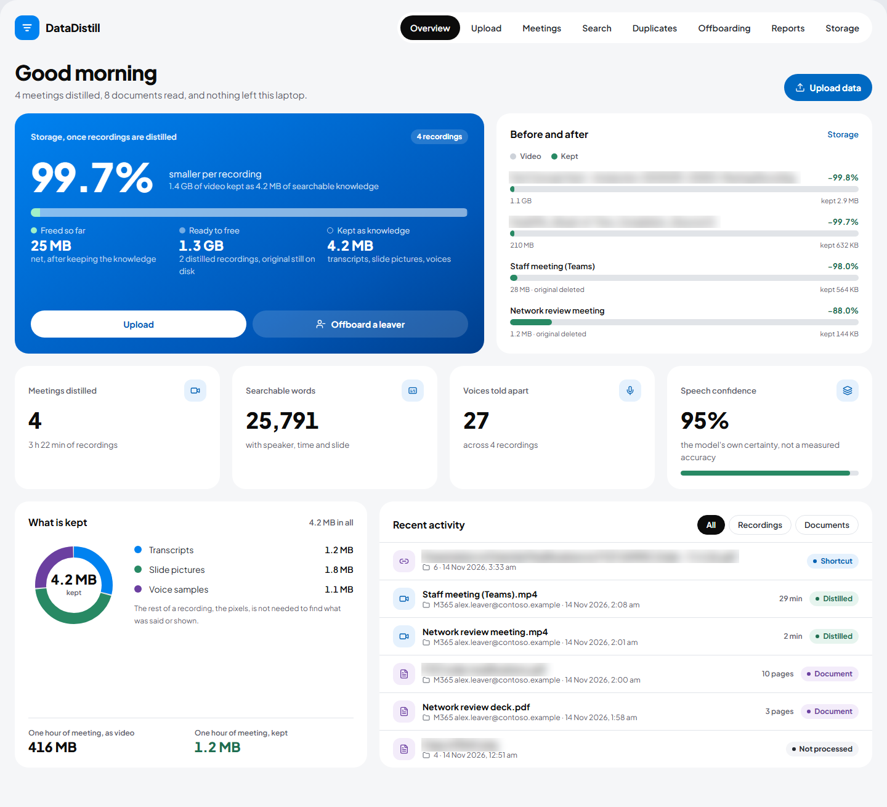
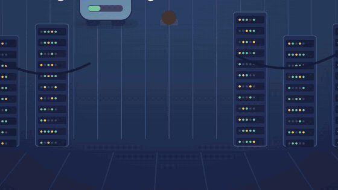
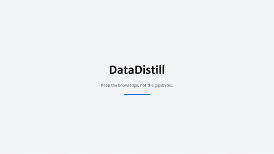
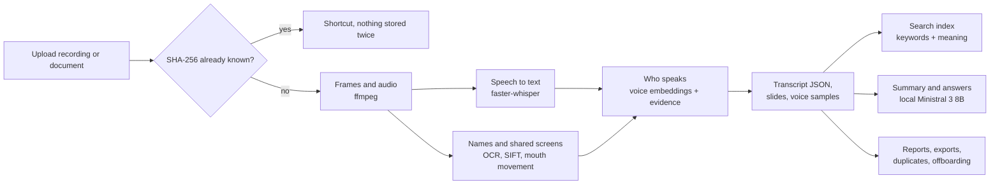
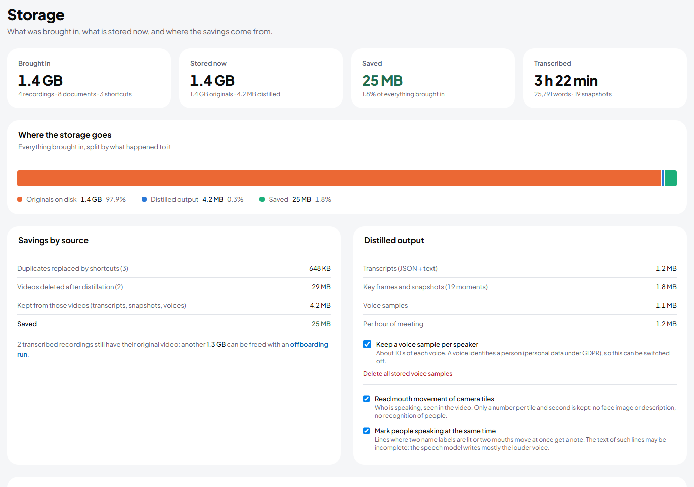
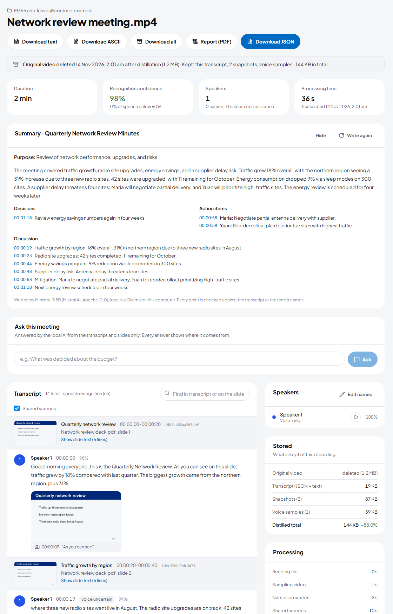
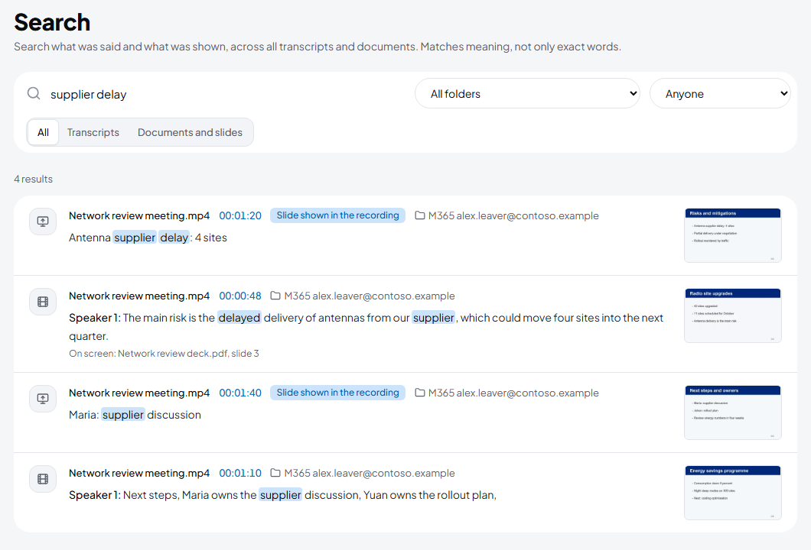
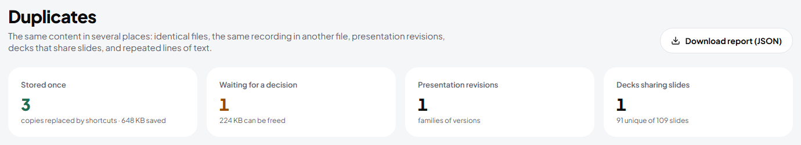
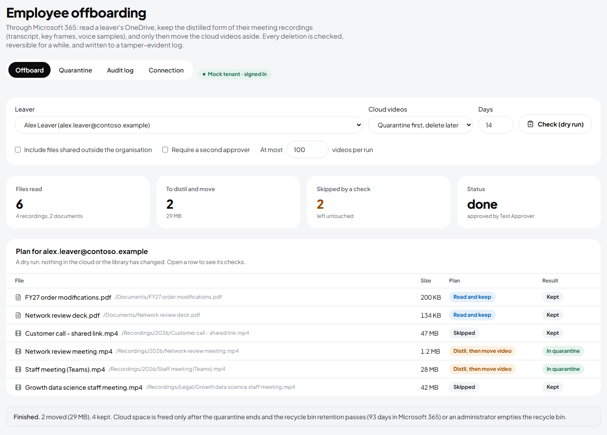
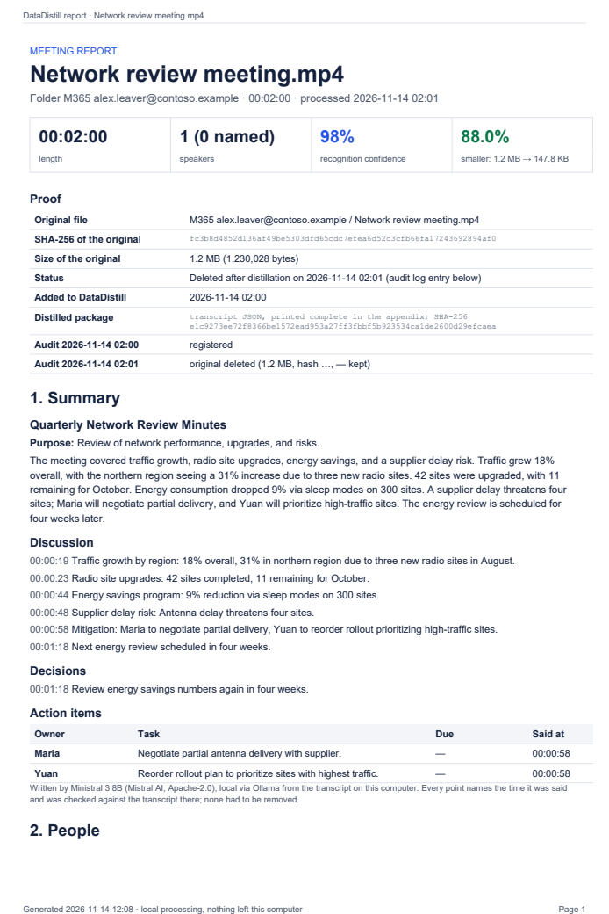

# DataDistill

**Turn meeting recordings into small, speaker-attributed, AI-ready text, and free the storage they take. Everything runs on one laptop.**

*Built for the Ericsson "Data Storage Optimization" challenge, Campor x BUILD Hackathon, 13-15 November 2026.*

     



## See it in action

[](docs/video/datadistill-pitch.mp4)

*The 1-minute pitch, playing above. Click it for the full video with sound.*

| Platform walkthrough (50 s, the real pages) | "How real is the AI replay?" (35 s) |
|---|---|
| [](docs/video/datadistill-walkthrough.mp4) | [](docs/video/datadistill-replay-explainer.mp4) |

The previews play on this page without sound; click one to open the MP4 in GitHub's player. The replay explainer shows what is real,
what is generated and what is private when a meeting is rebuilt from its distilled output: the voices and slides are real, the
picture around them is generated, and faces become avatars on purpose so no face is ever stored. At 20 random moments, the rebuilt
replay showed the same slide as the original in 19 (counted by eye), and the stored form was 98.5% smaller than the original
recording. The walkthrough is rebuilt from the screenshots in [docs/images](docs/images) by `scripts/make_walkthrough_video.py`.
All three are animated or built from our own demo meeting; no partner or test recordings appear in them.

## The problem

A two-hour meeting recording is about 1 GB. Nobody can search inside it, copies pile up across SharePoint and OneDrive, and
when someone leaves their files stay behind. Storage fills up, so valuable knowledge gets deleted with the video.

## What DataDistill does

A recording becomes a package of a few megabytes that an AI (or a person) can read and search:

- **The words, with timestamps and who said them**, in English, Swedish and French. A name is given only with evidence.
- **Every shared slide**, stored once and shown where it changes, matched to the uploaded deck when there is one.
- **A short voice sample** per speaker, and a structured JSON file (`datadistill.transcript/v1`).
- **Duplicates found**: exact copies, the same recording in another encoding, revisions of a deck, even single repeated slides and lines.
- **Search** by words, meaning or person ("what did Dana say about the budget").
- **Safe offboarding** of a leaver's Microsoft 365 videos: dry run, approval, hash-verified download, distil, quarantine, then delete. Every step is logged.

| Measured on our test recordings (14 Nov) | |
|---|---|
| Size per recording | **99.7% smaller** (1.22 GB to 3.0 MB, 220 MB to 0.65 MB) |
| Four recordings together | 1.47 GB to 4.4 MB |
| Speed, 2 h recording (RTX 4060 laptop) | 31 min to 11 min after our fixes |
| Search quality (22 queries) | mean reciprocal rank 0.69 to 0.84 |
| Words under the right person's name (AMI meeting) | 91.5% |
| Cost, cloud services | $0, nothing leaves the machine |

Every number has a limit, and the limits are written next to them in [docs/SOLUTION.md](docs/SOLUTION.md) (section 7).
The 99.7% compares video bytes with the kept package; originals are kept until the distilled copy is verified.

## How it works



The full explanation, with the reasoning behind each choice, is in [docs/SOLUTION.md](docs/SOLUTION.md).

## The workflow, step by step

The pictures below come from the running app on a small demo meeting we made ourselves (a synthetic quarterly network
review with its slide deck, played through a local mock Microsoft 365 tenant). Names of any partner-provided files are blurred or left out.

### 1. See what was saved

The Overview shows the saving per recording, what is freed and what is ready to free, and what is kept (above).
The Storage page adds the split of every byte and editable "what if" scenarios.



### 2. Read the meeting without watching it

Each recording becomes a page: a checked summary (decisions, action items with the time they were said), the dialogue by
speaker with timestamps and confidence, and each shared slide shown where it comes on screen. "Ask this meeting" answers from
the record only, and every answer links back to the line it came from. The right column says exactly what was kept and how long each step took.



### 3. Find anything, in what was said or shown

Search matches words and meaning across all transcripts and documents. Each hit opens the exact line and shows the slide that was on screen.
Typing a person's name gives everything that person said, recording by recording.



### 4. Find the copies

Identical files become shortcuts, the same recording in another encoding is caught before it is transcribed, and decks are compared page by page.



### 5. Free the space safely: offboarding a leaver

A dry run lists every file with named safety checks (protected, shared outside, too large). After approval a video is distilled, checked,
moved to quarantine, and only later deleted. Every step is in a tamper-evident log.



### 6. Keep the proof: one PDF per file

The report has the summary, people, quality, storage, the SHA-256 of the original and what happened to it, and the whole JSON printed at the end.



## Quick start

You need Windows, Python 3.13, Node.js 20+, and ideally an NVIDIA GPU. ffmpeg, Tesseract OCR and Ollama are installed separately.

```bash
git clone https://github.com/Nasaniamoghvarsha/datadistill-platform.git
cd datadistill-platform
winget install Gyan.FFmpeg UB-Mannheim.TesseractOCR
py -3.13 -m venv .venv
.venv\Scripts\pip install torch torchaudio --index-url https://download.pytorch.org/whl/cu126
.venv\Scripts\pip install -r requirements.txt
.venv\Scripts\pip install -e .
npm --prefix web install
npm --prefix web run build
.venv\Scripts\python scripts\fetch_models.py
ollama pull ministral-3:8b
.venv\Scripts\python scripts\check_env.py
```

Start it and open <http://127.0.0.1:8000>:

```bash
.venv\Scripts\datadistill.exe serve
```

Then use **Upload**, drop in a recording and the slides that were shown, and watch it become a transcript. Without a GPU it
still works, only slower. Without Ollama everything works except the summary and "Ask this meeting".

## Results

Measured on our test recordings on 14 November 2026 (one RTX 4060 laptop). Limits are listed next to each number in
[docs/SOLUTION.md](docs/SOLUTION.md) section 7, and every measurement can be repeated with [benchmarks/README.md](benchmarks/README.md).

| Area | Result | Limit |
|---|---|---|
| Storage per recording | **99.7% smaller** (text, slide pictures, voice samples kept) | Compares video bytes with the package; with the full audio track it is 98.5% |
| Realised saving | Originals are kept until verified; 1.3 GB more is ready to free | Net saving grows as originals are deleted |
| Site-wide estimate | 94 to 97% | A scenario with editable assumptions, not a measurement |
| Speed | 2 h recording in 11.1 min (31.1 min before our fixes) | One laptop GPU |
| Speech accuracy | Word error 1.2% (clean synthetic), 15.8% (4 people, one mixed track) | Real noisy meetings vary |
| Who spoke | 91.5% of words under the right name on the AMI meeting | Voices with no evidence stay "Speaker N" |
| Search | Mean reciprocal rank 0.69 to 0.84 on 22 queries | One meeting; a 1-2 query difference is not evidence |
| Answers from the record | 20 of 20 on the FDA transcript, every number and name checked | Loose talk can still produce a wrong answer |
| Diagram slides | PPTX and PDF readers 18 of 18 arrows | The picture reader got 11 of 18 |
| Offboarding | 18 HTTP tests and a browser run: 2 videos quarantined, protected and shared files skipped | Mock tenant only |
| Automated tests | 170 passing, each in an isolated temporary library | |

## Command line

After `pip install -e .` the `datadistill` command is available in the virtual environment.

| Command | What it does |
|---|---|
| `datadistill serve` | Web app and API on 127.0.0.1:8000 |
| `datadistill scan` | Register files found under `data/` |
| `datadistill process-all` | Process every new file without the web app |
| `datadistill reprocess [--kind video\|document]` | Re-run processing |
| `datadistill export` | Rewrite `transcript.json` and `transcript.md` for every recording |
| `datadistill extracts [ids]` | Make snapshots and voice samples for recordings transcribed earlier |
| `datadistill offboard <leaver address>` | Dry-run plan for a leaver's OneDrive (Microsoft 365 or the mock tenant) |
| `datadistill accuracy <id> <reference> [--offset auto\|<s>]` | Compare a transcript with a human reference: word error, who-spoke-when error, names |
| `datadistill questions <id> <questions.json> [--no-ai]` | Are the answers still in the distilled output, and can the local AI find them? |
| `datadistill ami-reference <words_dir> <meeting> <out.vtt>` | Turn AMI corpus word files into a reference `.vtt` |

Global options: `--data-dir` and `--output-dir` (defaults `./data` and `./output`). Put recordings and the slides shown in them
in the same folder under `data/<meeting>/`, or upload them in the web app. A Teams transcript next to a video
(`meeting.mp4` + `meeting.vtt`) is used automatically for exact speaker names.

Developing the web app with hot reload (proxies `/api` to the backend):

```bash
.venv\Scripts\datadistill.exe serve
npm --prefix web run dev
```

Checks before a pull request:

```bash
.venv\Scripts\python -m unittest discover -s tests
npm --prefix web run build
.venv\Scripts\python scripts\check_env.py
```

Rebuild the media in this repository:

```bash
.venv\Scripts\python scripts\make_solution_pdf.py          # docs/DataDistill-Solution.pdf
.venv\Scripts\python scripts\make_walkthrough_video.py      # docs/video/datadistill-walkthrough.mp4
```

## The app

| Page | What it is for |
|---|---|
| **Overview** | What was distilled, saved and transcribed, before and after, recent activity |
| **Upload** | Folders, upload, live progress, files already known are recognised before uploading |
| **Meetings** | Dialogue by speaker, slides where they change, summary, "Ask this meeting", downloads |
| **Search** | Words and meaning, a person's name gives all that person said, per recording |
| **Duplicates** | Copies, same recording in another file, revisions, shared slides, page-by-page compare |
| **Offboarding** | Microsoft 365 leaver flow (runs against a local mock tenant, no tenant needed) |
| **Reports** | One self-contained PDF per file |
| **Storage** | Brought in, stored, saved, and editable savings scenarios |

Every page, command and rule is described in [docs/FEATURES.md](docs/FEATURES.md).

## Privacy

- All processing is local. No recording, transcript or slide is sent to a cloud service.
- The language model is a local one (Mistral or Meta models only, by team rule). Its answers are checked against the transcript, and a number or name that is not in the record is flagged.
- Partner (Ericsson) material is never committed; it lives in `ericsson data/`, which git ignores, and is deleted after the event.
- Test recordings and decks are not in the repository either: see [docs/TEST_MATERIAL.md](docs/TEST_MATERIAL.md).

## Repository layout

```
src/datadistill/   the pipeline (transcribe, speakers, identity, slides, match, docs, search, people, summary),
                   the API, the CLI and the Microsoft 365 / mock-tenant code
web/               React + Vite + Tailwind web app (web/src/pages: one file per page)
tests/             170 unit tests (no recordings needed)
benchmarks/        accuracy, question, search and diagram checks, with the results we measured
scripts/           environment check, model download, demo recorder
docs/              SOLUTION.md (the whole story), FEATURES.md (reference), TEST_MATERIAL.md, images, video
pitch/             code that builds our pitch video (the finished demo videos are in docs/video)
PROJECT_SPEC.md    requirements, design, decisions and the licence audit
CONTRIBUTING.md    how the team works together (also SECURITY.md, CODE_OF_CONDUCT.md, LICENSE, .github/ templates)
```

## Tests

```bash
.venv\Scripts\python -m unittest discover -s tests
npm --prefix web run build
```

Accuracy and search measurements, and how to repeat them, are in [benchmarks/README.md](benchmarks/README.md).

## Documents

| | |
|---|---|
| [docs/SOLUTION.md](docs/SOLUTION.md) | How it works, the stack, how we built it, what we tried, what we reused and what we built, why it is better, limits |
| [docs/DataDistill-Solution.pdf](docs/DataDistill-Solution.pdf) | The same document as a PDF to share |
| [docs/FEATURES.md](docs/FEATURES.md) | Feature and command reference |
| [PROJECT_SPEC.md](PROJECT_SPEC.md) | Requirements, design, licence audit, decisions |
| [benchmarks/README.md](benchmarks/README.md) | Every measurement and how to repeat it |
| [CONTRIBUTING.md](CONTRIBUTING.md) | Working rules for the team |
| [SECURITY.md](SECURITY.md) | What happens to data, what must never be committed, how to report a problem |
| [CODE_OF_CONDUCT.md](CODE_OF_CONDUCT.md) | How we treat each other |
| [docs/TEST_MATERIAL.md](docs/TEST_MATERIAL.md) | The test material that is not in git |

## Honest limits

- Speaker names need evidence on screen or in the speech; voices without any stay "Speaker N". Many audience voices stay unnamed.
- Speech accuracy varies with audio. Word error was 1.2% on clean synthetic speech and 15.8% on a four-person single-track meeting.
- Offboarding is tested against a mock Microsoft 365 tenant only; a real tenant needs an administrator's app registration and a supervised first run.
- Search quality was measured on one meeting; a one- or two-query difference is not evidence.

## How it was built

| Layer | What is in it | Where |
|---|---|---|
| **Contract** | One JSON shape (`datadistill.transcript/v1`) that every part reads or writes | `src/datadistill/package.py` |
| **Pipeline** | frames, names on screen, shared screens, speech, voices, identity, save, search index | `src/datadistill/pipeline.py` and the modules it calls |
| **Library** | SQLite database, content-addressed slide store, duplicates, jobs, storage accounting | `db.py`, `store.py`, `dedup.py`, `lines.py`, `jobs.py`, `storage.py` |
| **API** | FastAPI routes the web app uses; one process serves both | `api.py` |
| **Web app** | React pages: Overview, Upload, Meetings, Search, Duplicates, Offboarding, Reports, Storage | `web/src/pages` |
| **Microsoft 365** | Graph client, the offboarding flow, a local mock tenant with the same API | `graph.py`, `m365.py`, `graph_mock.py` |
| **Checks** | 170 unit tests, accuracy/question/search/diagram benchmarks | `tests/`, `benchmarks/` |

Four people worked in parallel on the pipeline and speech, screens and documents, the interface and search, and the platform and offboarding,
against the JSON contract above. The equal-contribution statement, the stages of the work, what we tried and dropped (for example Streamlit, PyMuPDF, cloud models),
and what is built versus reused are in [docs/SOLUTION.md](docs/SOLUTION.md). The AI coding assistant Claude Code (Anthropic) was used
during development, and every change was run against the tests and real recordings by the team.

## Everything we used

**Software we depend on** (all free; licences from each project)

| Purpose | Name | Licence |
|---|---|---|
| Language and API | Python, FastAPI, Uvicorn, SQLite | PSF, MIT, BSD, public domain |
| Web | React, React Router, Vite, TypeScript, Tailwind CSS, lucide-react | MIT, ISC |
| Fonts (bundled, no CDN) | Inter, Plus Jakarta Sans via Fontsource | SIL OFL |
| Speech to text | faster-whisper with OpenAI Whisper `large-v3-turbo` weights | MIT |
| Voices | SpeechBrain, ECAPA-TDNN (VoxCeleb), scikit-learn, SciPy | Apache-2.0, BSD |
| Mouth movement | MediaPipe Face Landmarker (Google) | Apache-2.0 |
| Screens and pictures | Tesseract OCR, OpenCV, Pillow, imagehash, rapidfuzz | Apache-2.0, BSD, MIT |
| Documents | pypdfium2, pdfplumber, python-pptx | Apache-2.0/BSD, MIT |
| Search | rank_bm25, sentence-transformers (multilingual MiniLM, cross-encoder), FAISS | Apache-2.0, MIT |
| Local language model | Ollama running Ministral 3 8B (Mistral AI) | MIT, Apache-2.0 |
| Reports | reportlab | BSD |
| Media | ffmpeg (separate program, not linked) | LGPL/GPL |
| Pitch video (optional) | Kokoro-82M text to speech, kokoro-onnx, numpy | Apache-2.0 |

PyMuPDF was removed because of its AGPL licence, and ffmpeg is called as a separate program because of its GPL licence. The exact list is in `requirements.txt` and `web/package.json`; the audit of licences is in [PROJECT_SPEC.md](PROJECT_SPEC.md) section 1.1.
Models download on first use into `.models/` and are not stored in git.

**Test data**

- Public meeting recordings and a public FDA advisory committee meeting (agenda, slides, official transcript) as human references.
- The AMI meeting corpus (CC BY 4.0) for one speaker benchmark.
- A synthetic "network review" meeting and deck that we generated, used for the screenshots above.
- Material provided by Ericsson for the challenge: used locally, never committed, deleted after the event.

**Hardware we developed and measured on:** one Windows laptop with an NVIDIA RTX 4060 (8 GB).

## Contributors

DataDistill was built by a team of four at the Campor x BUILD Hackathon, 13-15 November 2026.

| | |
|---|---|
| [@Nasaniamoghvarsha](https://github.com/Nasaniamoghvarsha) | Contributor |
| [@rrithvik17](https://github.com/rrithvik17) | Contributor |
| [@hareesh1807](https://github.com/hareesh1807) | Contributor |
| [@SaiManas2106](https://github.com/SaiManas2106) | Contributor |

All four of us contributed equally; see [docs/SOLUTION.md](docs/SOLUTION.md) section 8, and section 10 for what we reused and what we built. Want to help? Read [CONTRIBUTING.md](CONTRIBUTING.md).

## Licence

Released under the [MIT License](LICENSE). Every third-party component we use is MIT, BSD, Apache-2.0 or MPL (see the audit in PROJECT_SPEC.md);
ffmpeg is called as a separate program. Partner-provided material is not part of this repository and is not covered by the licence.
